# 03 — System Architecture and Data Flow Diagrams

**Project:** Patient Medical Records Management System (PMRMS)  
**Document version:** 1.0  
**Date:** 18 November 2026  
**Status:** Proposed technical design — academic prototype  
**Related:** `01-project-overview-and-functional-requirements_PR.md`; `02-system-actors-use-cases-and-business-rules_PR.md`

> **Scope:** The system demonstrates secure medical-record handling with **fictional** patients. It must not be deployed with real clinical data without additional legal, privacy, operational and security review.

## 1. Purpose and design commitments

This document turns the functional requirements and actor rules into an implementable architecture. It describes components, data boundaries, request sequences, data-flow diagrams (DFDs), deployment, realtime notification delivery, database RLS, private PDF storage and failure handling.

The agreed decisions are:

| Concern | Technology / decision |
|---|---|
| User interface | Next.js + TypeScript + Tailwind CSS; three role-specific dashboard areas |
| API / domain rules | NestJS REST API; backend is the sole clinical API |
| Login | NestJS custom JWT, Argon2id, short-lived access tokens and rotated refresh sessions |
| Database | PostgreSQL hosted by Supabase; Prisma ORM and migrations |
| Database authorization | NestJS ownership/assignment checks **and** PostgreSQL Row Level Security (RLS) |
| Realtime | **Supabase Realtime private Broadcast**, not NestJS Socket.IO |
| Notification persistence | `notifications` table in PostgreSQL; Broadcast is an update signal |
| Document storage | Private Cloudflare R2 bucket; AWS SDK v3 on the backend |
| Roles | `ADMIN`, `DOCTOR`, `PATIENT` |
| Tests | Jest + Supertest, SQL policy tests, optional Playwright |
| Deployment | Vercel for Next.js; suitable free/low-cost HTTP host for NestJS; managed Supabase and R2 |
| Explicit exclusions | Django, Better Auth, Supabase Auth, Supabase Storage, payment processing |

**Nonnegotiable rule:** Hiding an element in Next.js is not authorization. Backend checks and the relevant database policy must still restrict access.

## 2. Architectural style

The system follows a **modular monolith with a separate frontend**. NestJS contains the clinical modules in one deployable backend. This is simpler to implement and explain than microservices and still demonstrates separation of concerns.

- **Presentation tier:** Next.js renders dashboards, validates for usability, and manages loading/empty/error states.
- **Application tier:** NestJS authenticates requests, applies role and relationship rules, validates DTOs, coordinates data/files, logs accesses and shapes responses.
- **Data tier:** PostgreSQL stores structured data; Cloudflare R2 stores PDF bytes; Supabase Realtime delivers nonclinical update signals.
- **External managed services:** Supabase database and Realtime, Cloudflare R2. Neither decides whether a user may read a clinical record; the application and database policies decide that.

### 2.1 Component diagram

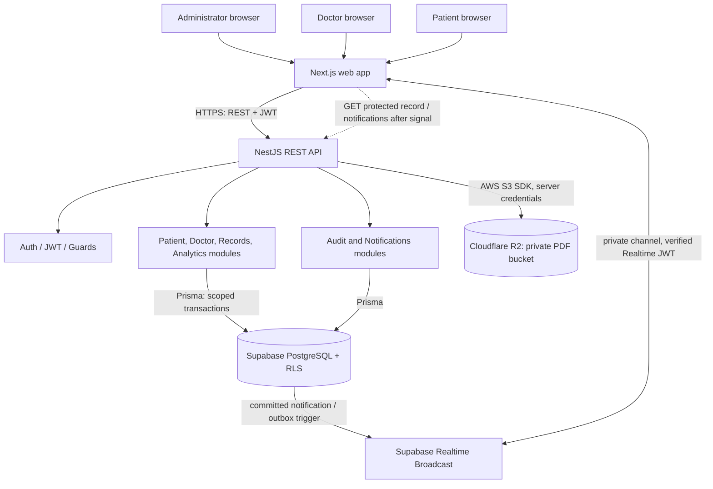

The arrow from PostgreSQL to Realtime is conceptual: the implementation uses a **database trigger / database-side broadcast** on a deliberately minimal event record, not arbitrary direct browser subscriptions to clinical tables. It does **not** broadcast whole `records` rows.

### 2.2 Key trust boundaries

| Boundary | Trusted component | Untrusted input | Mandatory enforcement |
|---|---|---|---|
| Browser → API | NestJS | Any browser payload, ID, role or token | JWT signature, expiry, active account, validation, RBAC, resource permission |
| API → database | Restricted application DB role | Authenticated user context set by API | RLS, foreign keys, uniqueness, transactional consistency |
| Browser → Realtime | Supabase Realtime verification + RLS | Channel name, token and subscription attempt | Valid Supabase-compatible JWT; private-channel RLS on `realtime.messages` |
| API → R2 | Backend-only R2 credentials | Requested record ID, file content | Record access check, MIME/content/size checks, short URL expiry |
| Browser → private PDF | Temporary authorized access | Copied signed URL | Short-lived capability URL; no public bucket or permanent URL |
| Admin → clinical domain | No default clinical permission | Admin clinical record request | Deny by default, even for ADMIN |

## 3. Deployment architecture

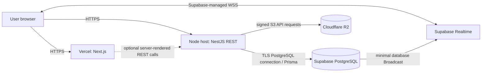

**Deployment implication:** The NestJS host only needs to serve ordinary HTTPS REST calls; it does not maintain application WebSocket sessions. A free host that sleeps can still delay API calls, so the UI must show retry/error states. Supabase Realtime depends on the Supabase project being active and users having a working network connection; it is **not guaranteed offline push delivery**.

### 3.1 Environments

| Environment | Purpose | Data | Secrets |
|---|---|---|---|
| Local | Development and tests | Synthetic seed records | `.env` files excluded from Git |
| Test / staging (if possible) | Authorization / cross-user verification | Dedicated synthetic dataset | Separate test credentials, R2 prefix or bucket |
| Production demo | Professor's live demonstration | Fictional accounts and PDFs only | Host environment secrets; no passwords in README |

**Never commit:** PostgreSQL runtime and migration passwords, R2 access key/secret, JWT private signing keys or Supabase privileged credentials.

## 4. Next.js structure

Three role-based route groups share components but are protected by server-side and API-side checks.

```text
apps/web/
  app/
    (public)/login/page.tsx
    (public)/register/page.tsx           # patient signup / doctor application
    (dashboard)/admin/...
      users/  doctor-approvals/  assignments/  audit-logs/
    (dashboard)/doctor/...
      patients/  records/  analytics/  notifications/
    (dashboard)/patient/...
      records/  timeline/  notifications/  profile/
    unauthorized/page.tsx
  components/                           # tables, record cards, timeline, forms, PDF viewer
  features/                             # auth, patients, records, notifications
  lib/                                  # typed REST client, Supabase Realtime client
```

Rules:

1. The UI obtains clinical data **only through NestJS**. Do not call `supabase.from('records')` in the browser.
2. Server-side page guards improve navigation, but **do not replace** NestJS guards.
3. A Broadcast event only invalidates/refetches the relevant query, e.g. patient timeline or unread count.
4. Provide skeletons, empty messages, validation errors, retry states and 401/403/404/409 handling.
5. Never store refresh tokens in `localStorage`; use secure HttpOnly cookies. Design access-token handling to minimize exposure to injected JavaScript. Protect cookie-based endpoints against CSRF, configure CORS and secure cookie settings according to the deployed domains.
6. Prevent caching of patient-specific medical API responses in shared/public caches (`Cache-Control: private, no-store` for sensitive responses).

## 5. NestJS backend modules

```text
apps/api/src/
  app.module.ts
  common/
    guards/            # AccessJwtGuard, RolesGuard, ClinicalAccessGuard
    decorators/        # CurrentUser, Roles
    filters/           # structured HTTP exceptions
    interceptors/      # safe request context, logging (no medical payloads)
    pipes/             # DTO validation
  auth/                # registration, login, refresh, logout, realtime token
  users/               # account status and profile metadata
  admin/               # approvals, assignments, user management
  doctors/             # doctor profile and authorized patient list
  patients/            # patient profile / relationships
  records/             # CRUD, archive, timeline, concurrency
  files/               # PDF validation, R2 client, signed URL, cleanup
  notifications/       # durable notification list / read state
  analytics/           # scope-limited records per diagnosis
  audit/               # access attempts, management actions
  prisma/              # database client and scoped transaction helper
  health/              # non-sensitive liveness endpoint
```

### 5.1 Responsibilities and access

| Module | Main responsibilities | Clinical access? |
|---|---|---|
| `AuthModule` | Argon2id, JWT, refresh sessions, token revocation, active-user checks | No record contents |
| `AdminModule` | Doctor verification, user suspension, assign/revoke doctor-patient links | No clinical reading by default |
| `PatientsModule` | Own profile / assigned patient metadata | Restricted |
| `RecordsModule` | Create, scoped list/view, versioned update, archive, timeline | Yes, authorized doctor/patient only |
| `FilesModule` | R2 object upload/delete and authorized PDF retrieval | Yes, same record access rule |
| `NotificationsModule` | Persist and list recipient notifications; mark read | Recipient only |
| `AnalyticsModule` | Group diagnosis counts across authorized records | Doctor-scoped; never global by default |
| `AuditModule` | Durable attempt/outcome trail and management audit | Admin sees security metadata, not clinical contents |
| `PrismaModule` | Connection lifecycle, transactions, RLS identity context | No permissions by itself |

### 5.2 Common authorization algorithm

```text
Request → authenticate token → load active user/role
        → validate input → determine resource/relationship
        → authorize action → execute scoped database operation
        → audit attempt + outcome → return sanitized response
```

For record access: a **patient** may read only records whose `patient.user_id` equals their verified identity; an **approved doctor** may read only records whose patient currently has an active assignment to them; an **admin** is denied clinical access by default. Client-supplied IDs are selectors, **never claims of ownership**. Some denied cross-patient reads may deliberately return 404 to avoid confirming resource existence; the audit log still records denial.

**Audit reliability:** Use a dedicated append-only audit workflow or transactionally persisted event where feasible. Catching a forbidden request in an HTTP guard and logging asynchronously alone is insufficient to guarantee every attempt is recorded. Persist a denied-attempt log before completing the response; consider fail-closed behavior if a mandatory audit write fails. Do not put diagnoses in generic HTTP request logs.

## 6. Preliminary logical data model

The authoritative ERD and Prisma definitions belong in Document 04. This section identifies data stores and relations required by the architecture.

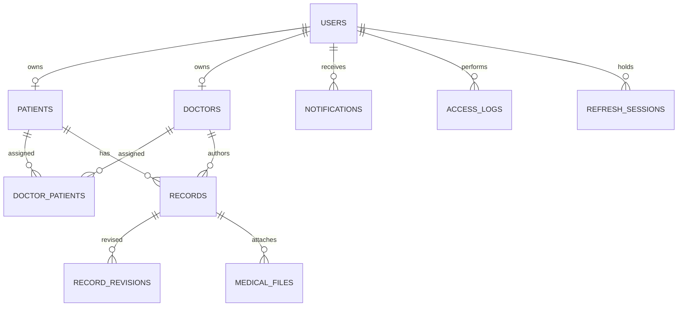

| Store | Purpose | Important controls |
|---|---|---|
| `users` | Account identity, role and lifecycle | Unique email; cannot self-promote |
| `patients` / `doctors` | Role-specific profile | Unique `user_id`, FK integrity |
| `doctor_patients` | Current and historical assignments | Prevent duplicate active assignment; revoke status |
| `records` | Diagnoses, patient/doctor references, record date, version/status | Scope to patient/doctor; `version` for concurrency |
| `medical_files` | R2 `object_key`, MIME, checksum, size, owner record | No public URL; authenticated lookup |
| `record_revisions` | Safe correction trail | Append-only history where supported |
| `access_logs` | Attempted and completed access events | Minimal metadata; protected from regular users |
| `notifications` | Durable unread/read status, recipient and minimal type/link | Owner-only reads/updates |
| `refresh_sessions` | Hashed refresh token identifiers, rotation/revocation | Revocable; indexed lookup |
| `outbox_events` (recommended) | Recoverable events to be broadcast | Immutable payload; no medical content |

**Schema compatibility note:** Documents 01–02 refer to a legacy `records.file_url` requirement. Keep a `file_key` or a normalized `medical_files.object_key` in the final schema, and explain that it replaces publicly accessible URLs. If the professor requires demonstrating a `file_url` column, use it as a **private internal object path**, never as a permanent public link.

### 6.1 Database constraints

- Primary keys for all tables, required fields and foreign keys for `records.patient_id`, `records.doctor_id` and assignments.
- Unique email; unique role-profile-to-user link.
- Check valid enum/state values and `version >= 1`.
- Seed **at least 10** synthetic rows in the relevant exercise tables; use two patient accounts and multiple doctor assignments to prove isolation.
- Index `records(patient_id, record_date)`, `records(doctor_id)`, assignment status, notification recipient/read state and audit timestamp.

## 7. Data-flow diagrams (DFD)

DFDs describe **data moving between actors, processes and stores**, not necessarily call order. Sequence diagrams in Section 8 show timing.

### 7.1 Context diagram (Level 0)

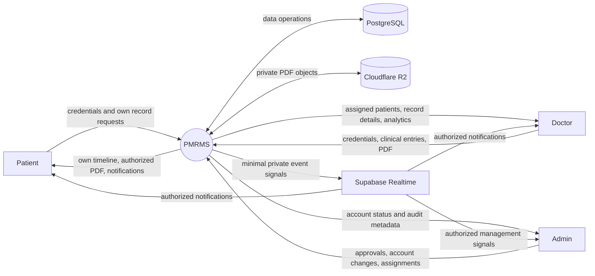

### 7.2 Level 1 DFD — principal processes

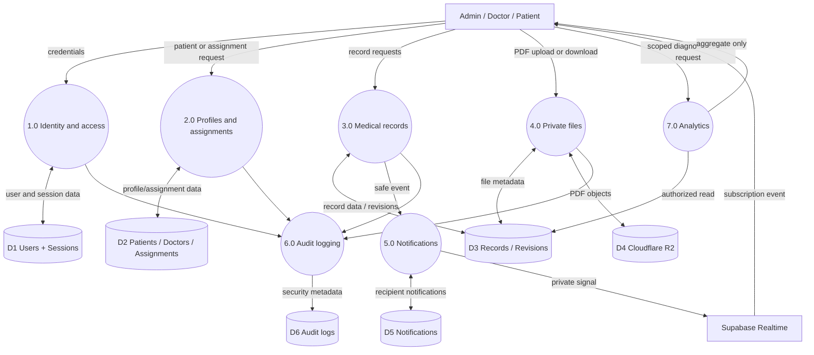

Every process accessing sensitive rows also uses the authenticated authorization context; the diagram intentionally avoids showing dozens of repetitive security arrows.

### 7.3 Level 2 DFD — open a medical record

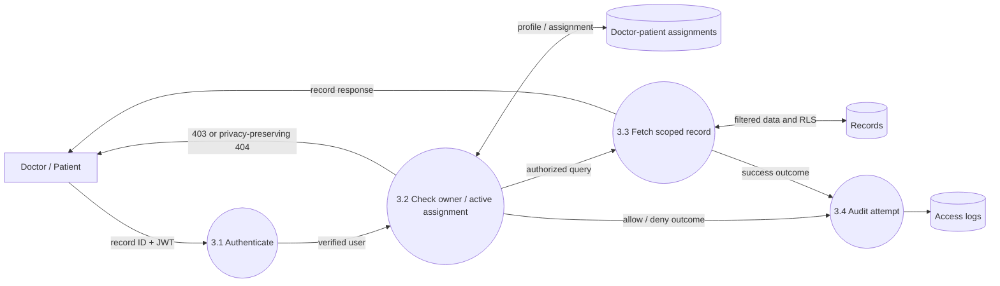

### 7.4 Level 2 DFD — create a record and notify patient

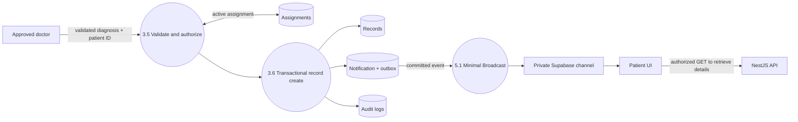

## 8. Sequence diagrams for the presentation

### 8.1 Mandatory four-step whiteboard trace — doctor opens record

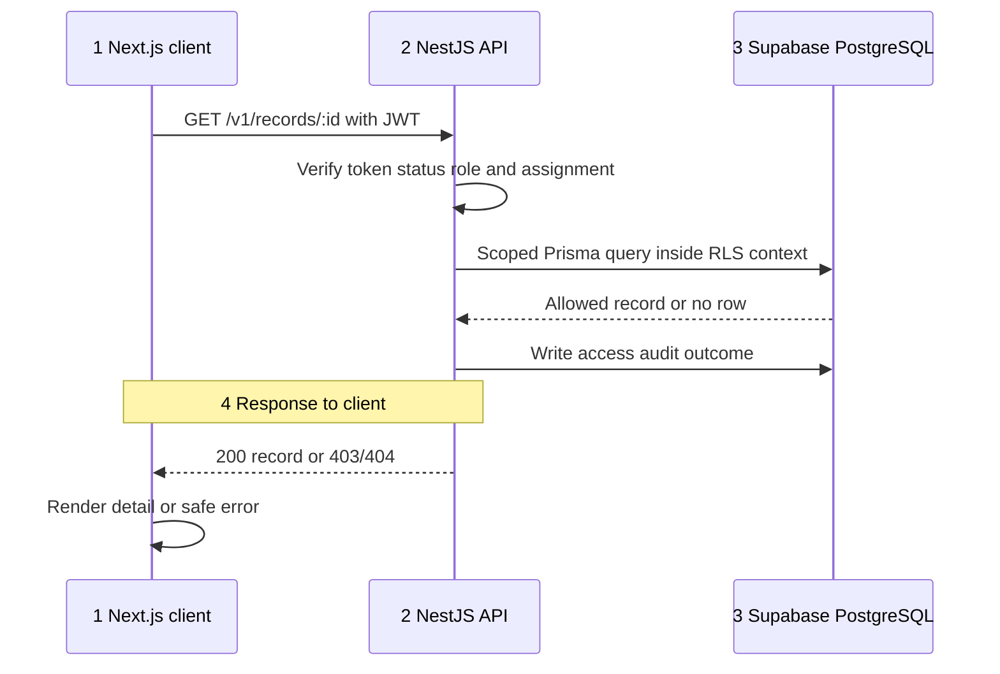

**How to explain (four steps):** (1) Next.js sends the request, (2) NestJS verifies the JWT and assignment, (3) PostgreSQL returns only permitted rows under RLS, (4) the API responds and the UI renders the result. The doctor cannot choose which patient's records they may read. Cloudflare R2 is used only if the doctor separately requests the PDF.

### 8.2 Medical PDF upload

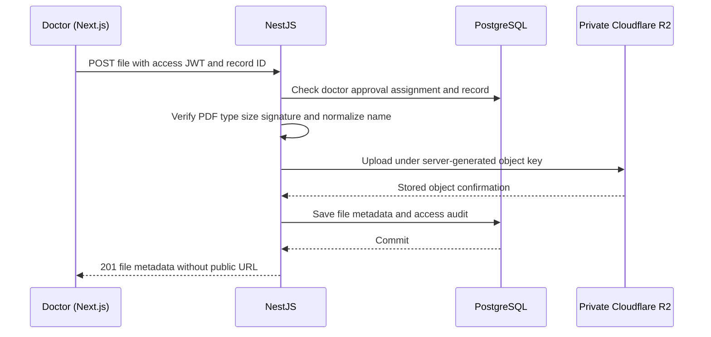

If metadata persistence fails after upload, the backend must remove the orphan object or queue cleanup. If the upload fails, the record must not reference a nonexistent file. A multi-service upload is **not** automatically atomic just because the database uses a transaction.

### 8.3 Medical PDF download

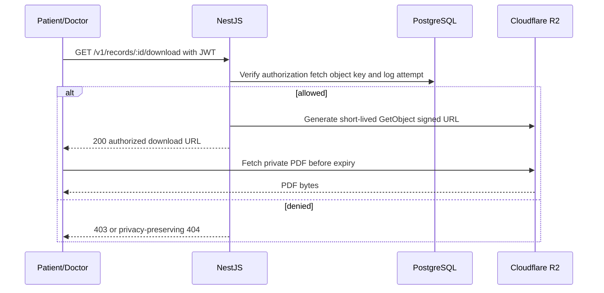

A signed URL is a temporary bearer capability: anyone who obtains it may use it before expiry. Set a short TTL, protect it from logs and analytics, configure CORS when needed, and **do not** confuse URL expiration with immediate revocation. If immediate revocation is required, proxy file bytes through NestJS instead.

### 8.4 Realtime notification after record creation

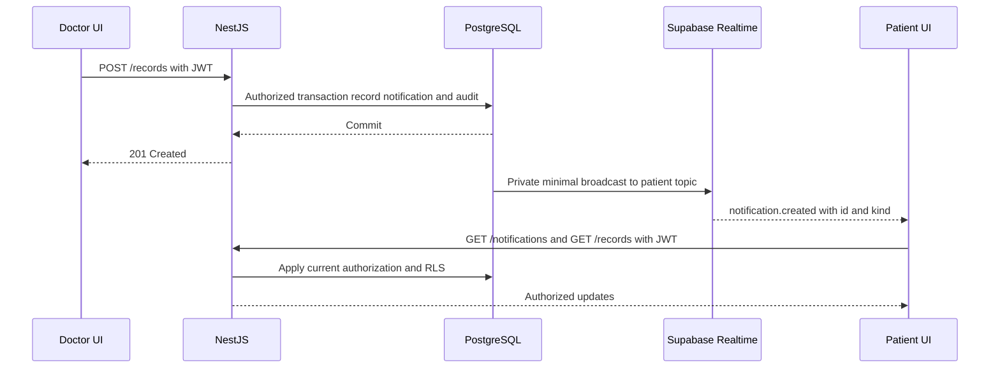

For reliability, the MVP may broadcast from a database trigger on committed `notifications` rows. A more robust version uses an **outbox** and retryable publisher. The client always refetches after reconnect; missed broadcasts are not lost medical records because the records and notifications are stored durably.

### 8.5 Two concurrent edits

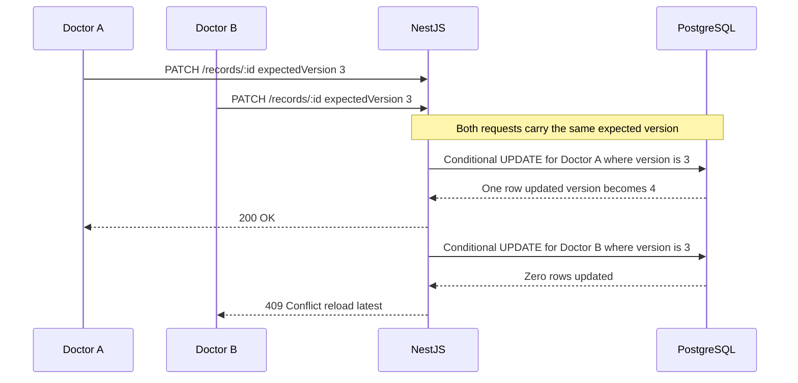

Only doctors who have editing permission may attempt the update. The version guard prevents accidental lost updates. It does not grant editing permissions.

## 9. Authentication design

### 9.1 REST authentication lifecycle

1. **Register:** Public users may create a `PATIENT` account or a pending doctor application; role comes from a trusted server workflow, not the request body. Admin bootstrap runs by secure CLI/seed only.
2. **Login:** `POST /v1/auth/login`. Argon2id verifies the stored password hash. Reject inactive accounts.
3. **Access:** The server signs a short-lived JWT containing a stable `sub` and only necessary claims; guards also consult current account state for high-value operations.
4. **Refresh:** A long-lived opaque refresh credential (or appropriate refresh token) is kept in an HttpOnly Secure cookie, rotated on use, stored server-side as a hash and revocable.
5. **Logout/suspension:** Revoke the refresh session; ensure access to protected resources is denied after account or assignment status changes even if a previously issued access JWT has not expired.
6. **Errors:** 401 unauthenticated; 403 permission denied; 404 for missing or concealed records; 400 malformed input; 409 stale update.

### 9.2 Supabase Realtime token lifecycle

A NestJS access JWT **must not be assumed to work in Supabase**. The implementation must configure a verifiable signing arrangement supported by the chosen Supabase project and issue a short-lived **Supabase-compatible Realtime JWT** with the necessary `role`, `sub` and expiry claims. Realtime uses private-channel RLS on `realtime.messages` to decide which topic that user can join.

```text
Next.js --(valid NestJS access token)--> POST /v1/auth/realtime-token
NestJS --(verify active user)-------> short-lived Supabase-compatible JWT
Next.js --(setAuth + subscribe)-----> Supabase Realtime private topic
Supabase --(JWT + realtime.messages RLS)--> channel join allow/deny
```

**Critical rules:**

- The custom token's signing key or JWKS configuration must actually be supported and verified by Supabase; these are **not** ordinary NestJS JWTs accepted by default.
- Browser code may receive a public Supabase project URL and publishable/anon key, but **never** the signing secret or Supabase privileged key.
- Define channel topics such as `user:<user-uuid>:notifications`. Do not trust the topic name alone; policy validates that JWT `sub` matches the topic's user.
- For the initial prototype, users may only **receive** Broadcast events. Limit channel insert/publish permissions to trusted database-side mechanisms.
- Refresh/rejoin channels when tokens expire, on role or assignment changes, and after reconnection. Short token validity limits stale permission windows, but **does not prove instantaneous subscription revocation**. For high-sensitivity events, use only generic invalidation and recheck access over REST.

## 10. PostgreSQL Row Level Security (RLS)

RLS is an independent database control and must be demonstrated in SQL tests as well as through NestJS. It is possible to write correct NestJS guards while accidentally connecting Prisma as a table owner or privileged role that bypasses RLS. **Avoid this.**

### 10.1 Runtime and migration identities

- **Migration role:** schema creation/migrations; secrets restricted to deployment/migration process.
- **Application runtime DB role:** only needed SQL privileges, `NOSUPERUSER`, `NOBYPASSRLS`; not a table owner with unintended bypass. Where appropriate, use `FORCE ROW LEVEL SECURITY` for target tables.
- **Transaction identity:** NestJS sets a validated user ID/role with transaction-scoped `set_config(...)`; protected queries run in the **same Prisma transaction and connection**.
- **Fail closed:** If context is absent/invalid, RLS rejects reads and mutations by default.

Conceptual pattern (not final migration SQL):

```ts
return prisma.$transaction(async (tx) => {
  await tx.$executeRaw`SELECT set_config('app.user_id', ${verifiedUserId}, true)`;
  await tx.$executeRaw`SELECT set_config('app.role', ${verifiedRole}, true)`;
  return tx.record.findMany({ where: { /* independently scoped filter */ } });
});
```

`true` makes the setting transaction-local; do not set it on one connection and execute queries on another. For raw SQL use parameterized queries only. **Session variables are not cryptographic proof of identity**: their correctness relies on trusted NestJS code, database privileges and preventing SQL injection. Keep role and assignment authorization in backend logic as well.

### 10.2 Policies to model in Document 04

| Table | Example database-level rule |
|---|---|
| `patients` | Patient can read own row; doctor can read assigned patient metadata; admin sees limited management columns via dedicated view/query |
| `records` | Patient owns row or doctor has active assignment; admin denied clinical read; authorized doctor inserts/edits |
| `medical_files` | Mirrors parent record's access; no unrestricted select |
| `notifications` | Only recipient can select/update read state; service writes through restricted trusted workflow |
| `doctor_patients` | Admin manages; doctor/patient read only relation rows needed for their permitted operations |
| `access_logs` | Inserts via controlled service; selective admin metadata access; no end-user broad reads |
| `realtime.messages` | `private` channel read only for matching authenticated subject; no client-side publish |

RLS alone does not replace column-level privacy. If admins must see names and account status but not diagnoses, use carefully scoped admin queries/views and privileges.

## 11. Realtime and notification contract

Use **minimal database Broadcast**, not `realtime.broadcast_changes()` with full medical records. A trusted trigger on `notifications` or an outbox can call `realtime.send()` with a tiny event payload.

| Event | Topic | Payload | UI action |
|---|---|---|---|
| `notification.created` | `user:<recipientId>:notifications` | `notificationId`, `kind` | Refetch unread count/list |
| `record.changed` | relevant **authorized** user topic | `recordId`, `kind` (optional) | Invalidate authorized records query |
| `assignment.changed` | affected user's topic | generic `kind` | Refetch authorized patient list and records |
| `account.status.changed` | affected user's topic | generic `kind` | Refresh session/permissions, possibly logout |

No diagnoses, medical notes, patient names, R2 keys, PDF filenames, dates of birth or access tokens in event payloads. For reduced information exposure, prefer notification IDs over record IDs, especially when an assignment may be revoked between event creation and delivery.

### 11.1 Reliability

- Commit record + notification + any event/outbox marker in a transaction.
- Only broadcast **after commit** / from a committed database event.
- A connected client refreshes the relevant REST resource; realtime is not the source of truth.
- On reconnect and page refresh, list unread notifications from PostgreSQL.
- Handle duplicate/out-of-order events by refetching and using stable notification IDs.
- Account suspension and assignment revocation immediately restrict REST and file access; existing channel subscriptions may remain until token refresh/reconnect unless explicitly disconnected. **Do not emit confidential content** to these channels.

## 12. Cloudflare R2 design

The private bucket is named conceptually `pmrms-medical-documents` (exact name configured per environment). Never enable anonymous public access.

### 12.1 Recommended object key

```text
patients/<opaque-patient-uuid>/records/<record-uuid>/<random-file-id>.pdf
```

Do not use patient names, email addresses, diagnosis codes or user-supplied filenames in object keys. Save the key and file metadata in PostgreSQL. Upload credentials remain server-side.

### 12.2 Upload / download controls

- Allow PDFs only; inspect MIME header and file signature and enforce configured maximum bytes.
- Validate doctor permissions both before starting upload and before associating the PDF with a record.
- Use server-generated object keys, checksum/size metadata and predictable cleanup of failed uploads.
- For downloads, NestJS checks the current owner's/doctor's rights before issuing a short-lived R2 S3 presigned URL or streaming the file through the API.
- Direct browser access to a presigned URL is temporary bearer access. Avoid displaying or logging the full URL; for sensitive demonstrations prefer API streaming if revocation timing matters.
- For browser-based R2 requests, configure restrictive R2 bucket CORS for the exact frontend origin(s).

## 13. API contract and error flow

NestJS mounts routes under **`/v1`**. Next.js proxies browser calls from **`/api/*`** to **`/v1/*`**, so the UI calls `/api/records/...` while the API serves `/v1/records/...`. Endpoint details will be finalized in Document 06.

| Domain | NestJS route | Method | Allowed role / rule |
|---|---|---|---|
| Auth | `/v1/auth/login`, `/v1/auth/refresh`, `/v1/auth/logout` | POST | Public login; session-bound refresh/logout |
| Realtime Auth | `/v1/auth/realtime-token` | POST | Any active authenticated user |
| Admin | `/v1/admin/doctors/:id/approve` | PATCH | ADMIN only |
| Admin | `/v1/admin/assignments` | POST | ADMIN only |
| Patients | `/v1/patients` | GET | Approved doctor sees assigned patients |
| Patients | `/v1/patients/me` | GET/PATCH | PATIENT own profile |
| Records | `/v1/records` | GET/POST | Scoped GET; approved doctor POST |
| Records | `/v1/records/:id` | GET/PATCH | Own/assigned GET; authorized clinician PATCH |
| Timeline | `/v1/patients/:id/records` | GET | Own or assigned patient |
| File | `/v1/records/:id/files` | POST | Authorized clinician |
| File | `/v1/records/:id/download` | GET | Own/assigned access |
| Notifications | `/v1/notifications`, `/v1/notifications/:id/read` | GET/PATCH | Recipient only |
| Analytics | `/v1/analytics/diagnoses` | GET | Approved doctor; authorized scope |
| Audit | `/v1/admin/audit-logs` | GET | ADMIN; metadata only |

### 13.1 Common error response (illustrative)

```json
{
  "statusCode": 404,
  "code": "RECORD_NOT_FOUND",
  "message": "Record not found or unavailable",
  "requestId": "demo-request-id"
}
```

Keep internal IDs, hidden resource existence and sensitive database details out of user-visible error messages. For a genuine 403 response, a clear message can say "You do not have permission to view this record." Use a consistent policy and demonstrate it in testing.

## 14. Failure and recovery scenarios

| Failure | Expected behavior | Evidence |
|---|---|---|
| Expired access JWT | 401; refresh/re-login through safe flow | Browser Network tab |
| Patient changes record ID | Denied 403/404; access logged | Audit table + curl |
| Admin tries to read diagnosis | Denied, despite ADMIN role | Security test |
| Doctor assignment revoked | Subsequent REST/PDF access denied | Two sessions test |
| Missing record | 404; friendly detail-page state | HTTP response + UI |
| Invalid diagnosis / file | 400; validation message | Form + API test |
| Duplicate active assignment | 409 or validation conflict | Database constraint test |
| Concurrent stale edit | 409; user prompted to reload | Two-user demo |
| R2 upload failure | Clear retry/error; no broken file reference | Mocked provider test |
| Supabase Realtime disconnects | Persistent data remains; reconnect and REST refetch | Disable network / reconnect |
| NestJS free host cold-start | Loading + sensible timeout/retry | Live demo observation |
| Missing DB RLS context | Query denied by default | Direct SQL / test role |
| Audit write failure for mandatory access event | Fail closed or use durable delivery design | Fault-injection test |

## 15. Testing strategy and evidence mapping

**Minimum:** Eight NestJS Jest/Supertest backend tests are required by the assignment. The recommended test collection is broader.

| ID | Test | Main component |
|---|---|---|
| T01 | Patient login succeeds with valid credentials | Auth |
| T02 | No JWT on protected route returns 401 | Guards |
| T03 | Patient reads own record | Records + RLS |
| T04 | Patient cannot read another patient's record, and attempt is logged | Records + Audit |
| T05 | Assigned approved doctor can create record | Records + Assignment |
| T06 | Invalid input returns 400 | DTO validation |
| T07 | Missing accessible record returns 404 | Records |
| T08 | Two stale version updates cannot both succeed | Prisma / DB concurrency |
| T09 | ADMIN cannot read clinical diagnosis or PDF | Clinical authorization |
| T10 | Doctor loses access when assignment revoked | Assignment revocation |
| T11 | Realtime JWT/channel policy blocks another patient's topic | Supabase Realtime RLS |
| T12 | Private PDF needs current authorization | Files + R2 |
| T13 | Event carries no diagnosis or R2 key | Notifications |
| T14 | RLS rejects request with missing DB actor context | PostgreSQL policy |
| T15 | Notifications survive disconnect and are retrieved by REST | Notification persistence |

**Academic evidence:** Screenshot of Network GET and HTTP status; Supabase Table Editor rows for synthetic records/audit logs; SQL RLS policy check; private R2 bucket; two browser sessions receiving a safe update; curl output from a partner using only README; successful automated test report; deployed frontend and API docs.

## 16. Step-by-step implementation sequence

1. Establish monorepo, environment variables, Docker/local PostgreSQL or Supabase dev DB, and README.
2. Design schema and migrations (Document 04), including seed data and first ADMIN bootstrap.
3. Build custom NestJS auth, user status, refresh rotation and role guards.
4. Implement secure assignment lifecycle and record-access policies.
5. Implement RLS using restricted DB role and transaction-scoped verified identity; write policy tests.
6. Implement clinical CRUD, timeline, optimistic concurrency and audit logging.
7. Integrate R2 private PDF uploads/downloads and cleanup behavior.
8. Add `notifications` persistence and minimal database Broadcast.
9. Configure custom JWT verification for Supabase Realtime and private `realtime.messages` policies.
10. Build responsive Next.js dashboards, forms, timeline, empty/error/loading states.
11. Add diagnosis analytics scoped to a permitted doctor.
12. Run at least eight automated backend tests, partner curl test, concurrency demo and deployment.

## 17. Open design points to lock in Document 04 / 05

1. **Database credentials:** Can the chosen Supabase project provide the needed restricted runtime DB role and a separate migration identity? Verify in the actual environment before claiming RLS protects Prisma calls.
2. **Custom Realtime JWT:** Verify the exact supported signing-key configuration and claims on the chosen Supabase project; test unauthorized private topic joins before enabling subscriptions.
3. **Doctor edits:** Decide whether any assigned approved doctor may correct a record or only its author. Until decided, assume **author-only corrections** with an audited workflow.
4. **File metadata:** Prefer a normalized `medical_files` table; maintain compatibility with the required `records.file_url` exercise by explaining the private `object_key` mapping.
5. **Event publication:** MVP database trigger vs robust outbox; never send entire medical rows to Broadcast.
6. **Admin access:** Only identity/approval/assignment and security metadata. No special emergency clinical-access override in this prototype.
7. **Log retention:** Choose a reasonable academic retention policy and never put medical detail bodies into logs.

## 18. Definition of done for architecture

- [ ] Reviewer can identify all tiers and trust boundaries from diagrams.
- [ ] Each of the three roles has a clear UI and backend permission scope.
- [ ] Clinical data is accessed only through NestJS; RLS works in the actual runtime DB role.
- [ ] PDF objects are private and access is checked before a signed download.
- [ ] Custom NestJS JWT and Supabase Realtime tokens are configured separately and verified.
- [ ] Realtime private channels refuse cross-user subscription and contain no clinical content.
- [ ] Notifications remain in PostgreSQL when clients disconnect.
- [ ] Create/read/update/deny workflows are traceable in audit records.
- [ ] A two-user edit conflict is handled without silent data loss.
- [ ] Live demo can explain the professor's four-step trace and prove behavior in browser tools.

## 19. Technical references

- Supabase — Broadcast from database: https://supabase.com/docs/guides/realtime/subscribing-to-database-changes
- Supabase — Realtime Broadcast and authorization: https://supabase.com/docs/guides/realtime/broadcast and https://supabase.com/docs/guides/realtime/authorization
- Cloudflare — R2 S3 presigned URLs: https://developers.cloudflare.com/r2/api/s3/presigned-urls/
- Cloudflare — R2 CORS: https://developers.cloudflare.com/r2/buckets/cors/
- Prisma — Example patterns for RLS and transaction context: https://github.com/prisma/prisma-client-extensions/tree/main/row-level-security

---

**Next document:** `04-database-design-erd-and-prisma-schema.md` — definitive schema, migrations, access policies, constraints and sample data.
