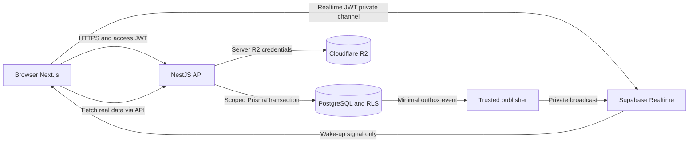
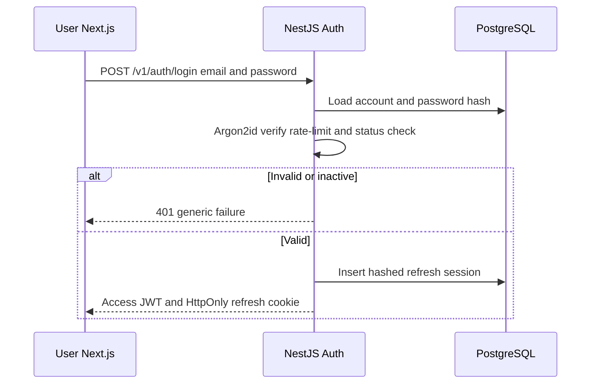
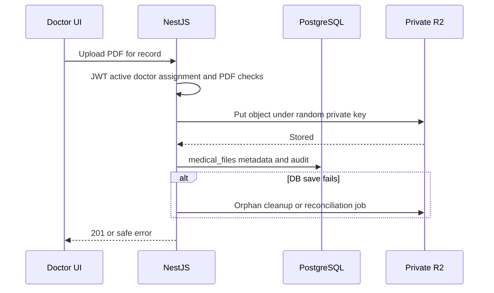
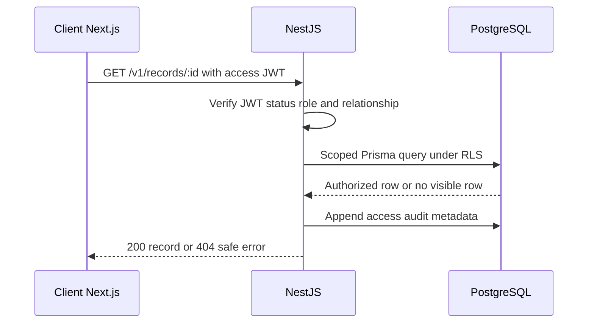

# 05 — Authentication, Authorization and Security Design

**Project:** Patient Medical Records Management System (PMRMS)  
**Version:** 2.0 — 18 November 2026  
**Status:** Implementation blueprint for Stage 1+ security controls  
**Related:** `01-project-overview-and-functional-requirements_PR.md` · `02-system-actors-use-cases-and-business-rules_PR.md` · `03-system-architecture-and-data-flow-diagrams.md` · `04-database-design-erd-and-prisma-schema.md`

> **Academic prototype:** fictional patients and generated PDFs only. This is a security design for demonstration — not certification for real clinical data.

---

## 1. Purpose

This document defines how PMRMS:

1. **Authenticates** users (who is calling?)  
2. **Authorizes** actions (what may they do, on which resource?)  
3. **Defends in depth** with PostgreSQL RLS  
4. **Secures** private PDFs and realtime signals  
5. **Audits** allowed and denied sensitive attempts  

| Layer | Technology | Security job |
|---|---|---|
| UI | Next.js | Safe session UX, role navigation — **never** the permission authority |
| API | NestJS REST `/v1` | JWT verify, RBAC, assignment checks, validation, audit |
| Passwords | Argon2id | Hashing and verification |
| Tokens | Custom NestJS JWT + opaque refresh | Access + rotation/revocation |
| Data | PostgreSQL + Prisma 7 | Constraints, RLS, transactional writes |
| Files | Cloudflare R2 | Private objects; short-lived authorized download |
| Realtime | Supabase private Broadcast | Wake-up signals only — no clinical payloads |
| Evidence | `access_logs` | Success and denial trails |

**Excluded:** Better Auth, Supabase Auth/Storage, NestJS Socket.IO, Django, payments.

### 1.1 Security principles

1. **Default deny** — every clinical endpoint needs verified identity + explicit permission.  
2. **Role is not enough** — doctor access also needs an **ACTIVE** assignment.  
3. **Admin ≠ clinical superuser** — no diagnoses/PDFs by default.  
4. **Never trust** client `userId`, `role`, or ownership claims.  
5. **RLS must run** under a non-bypass runtime DB role.  
6. **Realtime carries no clinical content** — IDs/kind only.  
7. **No public PDF bucket** and no permanent download URLs.  
8. **Denials are logged** without leaking clinical detail.  
9. **Permission changes apply on the next REST call**; realtime needs short tokens + rejoin.  
10. **Synthetic data only** for demos and tests.

---

## 2. Security logic (decision model)

### 2.1 Four layers of every protected request

```text
1. Authentication   → valid access JWT? active account?
2. RBAC             → does this role allow the operation class?
3. Relationship     → own resource? ACTIVE doctor–patient assignment?
4. RLS              → does the restricted DB role see this row?
(+ Audit)           → record attempt outcome on a trusted path
```

Fail closed at the first failed layer. UI hiding is not a layer.

### 2.2 Authorization invariants

| ID | Rule |
|---|---|
| A-01 | Public registration creates `PATIENT` only — role is server-assigned |
| A-02 | First `ADMIN` is created only by trusted seed/CLI — never public signup |
| A-03 | `SUSPENDED` users cannot use protected APIs or obtain realtime tokens |
| A-04 | Doctor clinical writes require `users.status=ACTIVE` **and** `doctors.verification_status=APPROVED` |
| A-05 | Doctor clinical access requires ACTIVE `doctor_patients` for that patient |
| A-06 | Patient clinical access requires `patients.user_id = authenticated.sub` |
| A-07 | Admin clinical read/download is denied by default |
| A-08 | Cross-patient IDOR returns **404** (conceal existence) + denied audit |
| A-09 | Wrong role for an operation returns **403** |
| A-10 | Missing/invalid token returns **401** |
| A-11 | Stale optimistic edit returns **409** only when the row is still visible |
| A-12 | Refresh tokens are opaque, hashed at rest, rotated, and family-revocable on reuse |
| A-13 | Access JWT role claim is re-checked against current DB state for high-value actions |
| A-14 | R2 download requires a fresh NestJS authorization check before any signed URL/stream |
| A-15 | Realtime JWT ≠ API JWT — separately issued, short-lived, topic-scoped |

### 2.3 Decision algorithm (clinical record read)

```text
INPUT: access JWT, recordId
VERIFY JWT signature, iss, aud, exp, alg
LOAD user from DB by sub → must be ACTIVE
IF role = ADMIN → DENY (403) + audit DENIED
RESOLVE visible record under scoped Prisma txn + RLS context
IF no row visible:
  audit DENIED (IDOR or missing)
  RETURN 404 "Record not found or unavailable"
ELSE
  audit SUCCESS
  RETURN 200 sanitized record
```

### 2.4 Threat → countermeasure map

| Threat | Example | Countermeasure |
|---|---|---|
| IDOR | Change `/records/:id` | Ownership/assignment + RLS + 404 + audit |
| Privilege escalation | Body `role=ADMIN` | Server-owned role; guarded admin bootstrap |
| Doctor overreach | Guess patient UUID | ACTIVE assignment check + scoped queries |
| Stolen access JWT | Replay bearer token | Short TTL, HTTPS, account-state recheck |
| Stolen refresh token | Reuse after rotation | Hashed storage, single-use rotation, family revoke |
| Credential stuffing | Password guessing | Argon2id, rate limit, generic errors |
| RLS bypass | Owner/service DB role | Restricted runtime role, `NOBYPASSRLS`, real-role tests |
| Realtime eavesdrop | Join another topic | Private channel + JWT `sub` policy |
| Realtime spoof | Browser Broadcast insert | Deny client publish; trusted publisher only |
| File disclosure | Predictable object path | Random keys, private bucket, authorized download |
| Lost update | Two PATCH same version | Conditional `version` update → 409 |
| Log wipe | User deletes evidence | Append-only audit path, no end-user DELETE |
| API cold start | Signal arrives, API asleep | Durable notifications + retryable REST |

---

## 3. Trust boundaries



| Boundary | Trusted side | Untrusted input | Enforcement |
|---|---|---|---|
| Browser → API | NestJS | Body, IDs, files, headers | JWT, status, RBAC, relationship, validation |
| API → DB | Restricted runtime role | Authenticated context set by API | RLS, FKs, CHECKs, transactions |
| Browser → Realtime | Supabase JWT verify + `realtime.messages` RLS | Topic name, token | Private topic = `user:<sub>` |
| API → R2 | Server credentials | Record/file IDs | Authz then signed URL or stream |
| Browser → PDF | Short-lived capability | Copied URL | Short TTL; prefer stream if revocation matters |

---

## 4. Actors and account lifecycle

| Role | How created | Clinical access |
|---|---|---|
| `PATIENT` | Public register | Own records/PDFs only |
| `DOCTOR` | Apply / invite → admin approve | ACTIVE assigned patients only |
| `ADMIN` | Trusted seed/CLI only | **None** for diagnoses/PDFs by default |

**Account status:** `PENDING` → `ACTIVE` → `SUSPENDED`  
**Doctor verification:** `PENDING` → `APPROVED` | `REJECTED`

```text
Clinical write allowed only when:
  user.status = ACTIVE
  AND role = DOCTOR
  AND doctor.verification_status = APPROVED
  AND doctor_patients(doctor, patient).status = ACTIVE
```

---

## 5. Authentication design

### 5.1 Passwords (Argon2id)

- Hash with Argon2id; store only the hash in `users.password_hash`.  
- Record memory/time/parallelism in server config; verify under host limits.  
- Enforce minimum length + confirmation UX.  
- Login errors are **generic** (no “email not found”).  
- Rate-limit login and auth endpoints.  
- HTTPS only; never put credentials/tokens in query strings.

### 5.2 Token model

**Access JWT** — short-lived API credential (default **15 minutes**).

```json
{
  "iss": "pmrms-api",
  "aud": "pmrms-api",
  "sub": "<user-uuid>",
  "jti": "<token-uuid>",
  "iat": 1795000000,
  "exp": 1795000900
}
```

Rules:

- Verify `iss`, `aud`, `exp`, and **algorithm explicitly** (reject `none` / unexpected algs).  
- Prefer asymmetric keys (RS256/EdDSA) with `kid` for rotation.  
- Do **not** authorize clinical actions from JWT role alone — reload account status/role from DB for high-value operations.

**Refresh token** — opaque high-entropy secret (default **7 days**).

| Property | Design |
|---|---|
| Storage | `refresh_sessions.token_hash` only (pepper + hash) |
| Cookie | `HttpOnly`, `Secure`, scoped path, `SameSite=Lax` (or stricter) |
| Rotation | Every refresh consumes old token and issues one successor |
| Reuse detection | Reuse of consumed token → revoke token family → force login |
| Logout / suspend | Revoke sessions immediately |

Extend schema (Document 04) with `family_id`, `replaced_by_id`, `last_used_at` when implementing full reuse detection.

### 5.3 Browser session pattern (this monorepo)

PMRMS uses Next.js same-origin proxy (`/api/*` → Nest `/v1/*`):

1. Access token held in **memory** (or short-lived secure cookie if BFF pattern chosen).  
2. Refresh token in **HttpOnly** cookie on auth endpoints.  
3. Clinical calls use `Authorization: Bearer <access>`.  
4. No medical bearer tokens in `localStorage`.  
5. CORS allowlist = `WEB_ORIGIN`; never `*` with credentials.  
6. Cookie refresh/logout endpoints need CSRF protection when cookies authenticate the call.

### 5.4 Login sequence



### 5.5 Refresh rotation logic

```text
1. Read refresh cookie → hash → lookup session
2. BEGIN transaction
3. Assert session active, unexpired, unrevoked; user ACTIVE
4. Mark old session consumed; insert successor (same family)
5. COMMIT
6. Set new cookie + return new access JWT
7. If old token already consumed → revoke family → 401 re-login
```

Coordinate client refresh with single-flight so parallel 401s do not race the same token.

### 5.6 Password reset (optional for demo)

One-time hashed reset challenge, short TTL, no account enumeration. On success, revoke **all** refresh sessions. If email is not configured, mark deferred — do not claim it works.

---

## 6. NestJS authorization architecture

### 6.1 Module map

```text
apps/api/src/
  auth/            login, refresh, logout, JWT issue/verify
  users/           profile, status
  admin/           approvals, assignments, suspension
  patients/        demographic access
  doctors/         clinician profile, assigned patients
  records/         clinical CRUD, archive, concurrency
  files/           R2 upload/download authz
  notifications/   inbox, mark read
  analytics/       scoped diagnosis counts
  audit/           trusted append-only writer
  realtime/        Supabase-verifiable short-lived JWT
  prisma/          runtime client + set_config transaction helper
  common/          guards, decorators, filters, request IDs
```

### 6.2 Guard pipeline

```text
Request
  → AccessJwtGuard        (signature, iss, aud, exp, alg)
  → AccountStatusGuard    (DB reload: ACTIVE + current role)
  → RolesGuard            (operation class)
  → ClinicalAccessService (ownership / ACTIVE assignment / verification)
  → Scoped Prisma + RLS   (transaction-local app.user_id / app.role)
  → AuditService          (SUCCESS | DENIED | ERROR)
  → Response
```

Register global guards via Nest `APP_GUARD`. Mark public routes explicitly (`@Public()`). Decorator metadata alone is not security — back it with tests.

### 6.3 Permission matrix

| Operation | Admin | Doctor | Patient |
|---|---|---|---|
| Manage account status | Yes | No | No |
| Approve/reject doctor | Yes | No | No |
| Assign/revoke doctor–patient | Yes | No | No |
| View identity/profile | Minimal admin fields | Assigned patients | Own |
| View diagnosis / notes | **No** | Assigned | Own |
| Create record | No | Assigned + approved | No |
| Update/archive record | No | Authoring rules + assignment | No |
| Download PDF | **No** | Assigned | Own |
| Diagnosis analytics | No | Assigned scope only | Own summary optional |
| Security audit metadata | Yes (no clinical body) | Own events optional | Own history optional |
| Notification inbox | Own | Own | Own |

### 6.4 Record read helper (intent)

```ts
async function authorizeRecordRead(actor: AuthenticatedUser, recordId: string) {
  if (actor.status !== 'ACTIVE') throw new UnauthorizedException();
  if (actor.role === 'ADMIN') {
    await audit.denied(actor, 'RECORD_READ', recordId, 'ADMIN_NO_CLINICAL');
    throw new ForbiddenException();
  }

  const record = await recordsRepository.findVisibleById(actor, recordId);
  // Repository runs inside RLS transaction with set_config(actor.id, actor.role)
  if (!record) {
    await audit.denied(actor, 'RECORD_READ', recordId, 'NOT_VISIBLE');
    throw new NotFoundException('Record not found or unavailable');
  }

  await audit.success(actor, 'RECORD_READ', recordId);
  return record;
}
```

### 6.5 HTTP / UI contract

| Condition | HTTP | Client behavior |
|---|---:|---|
| Missing/invalid token | 401 | Sign-in |
| Authenticated, wrong role | 403 | Access denied |
| Other patient's / hidden id | 404 | “Not found or unavailable” |
| Missing resource | 404 | Not found |
| Invalid DTO / file | 400 | Field errors |
| Duplicate assignment / stale version | 409 | Reload and retry |
| Rate limited | 429 | Retry later |
| Dependency down | 502/503 | Retry-safe UI |

Never return Prisma/SQL/stack traces or R2 paths to clients.

---

## 7. PostgreSQL RLS with Prisma 7

### 7.1 Roles decide whether RLS is real

| DB role | Purpose |
|---|---|
| Migration owner | DDL only — never web runtime |
| `pmrms_runtime` | Clinical queries under RLS |
| Auth/session role | Password verify + refresh sessions |
| Audit/outbox role | Append logs / publish events |

Prove at deploy time: `current_user`, `rolbypassrls = false`, policies enabled, grants correct. If the host cannot provision a restricted role, **do not claim RLS for the API path**.

### 7.2 Transaction-local context

```ts
return runtimePrisma.$transaction(async (tx) => {
  await tx.$executeRaw`
    SELECT set_config('app.user_id', ${actor.id}, true),
           set_config('app.role', ${actor.role}, true)
  `;
  return tx.medicalRecord.findMany({
    where: { status: 'ACTIVE' },
    orderBy: { recordDate: 'desc' },
  });
});
```

- Third argument `true` ⇒ transaction-local (safe with pooling).  
- Context values come only from verified auth — never from body/query.  
- All protected queries use **this** `tx` client.  
- Missing context ⇒ policies fail closed.

### 7.3 Acceptance criteria (with Document 04)

- `records`: patient owner / assigned doctor; admin denied.  
- `medical_files` / `record_revisions`: same visibility as parent.  
- `notifications`: recipient only; mark-read cannot change kind/recipient.  
- `refresh_sessions` / `access_logs` / `outbox_events`: no clinical-role access.  
- Test with the **same** runtime role and pooler mode NestJS uses.

### 7.4 Auditing RLS denials

A filtered `null` row does not automatically write evidence. NestJS must append denials through a **trusted audit writer** that still works when the clinical transaction sees nothing. Fail closed (or durable queue) if mandatory audit write fails for sensitive reads.

---

## 8. Supabase Realtime security

### 8.1 Second token contract

NestJS API JWTs are not assumed valid for Supabase.

```text
1. User holds valid NestJS access JWT
2. POST /v1/auth/realtime-token
3. NestJS checks ACTIVE user → issues short-lived Supabase-verifiable JWT
4. Next.js: realtime.setAuth(token) → subscribe private topic
5. Supabase verifies JWT + realtime.messages RLS
6. On expiry/role change: refresh token and resubscribe
```

Signing keys never ship to the browser. Validate claims against the live Supabase project before locking the implementation.

### 8.2 Topics and policies

**Topic:** `user:<authenticated-user-uuid>` (private only).

Policy intent:

- `SELECT` Broadcast only when topic matches JWT `sub`.  
- No client `INSERT` for trusted notification events.  
- Clinical `records` RLS is separate and still required.

```sql
-- Reference pattern — adapt and test against live Supabase claims
CREATE POLICY listen_to_own_updates
ON realtime.messages FOR SELECT TO authenticated
USING (
  extension = 'broadcast'
  AND realtime.topic() = 'user:' || (auth.jwt() ->> 'sub')
);
```

### 8.3 Payload minimization

```json
{
  "event": "notification.changed",
  "payload": { "notificationId": "<uuid>", "kind": "RECORD_CREATED" }
}
```

Forbidden in payloads: diagnosis, notes, names, birth dates, object keys, signed URLs. UI always refetches via NestJS.

### 8.4 Publication under free hosting

Record txn writes `notifications` + `outbox_events`. Publisher options:

1. DB trigger → `realtime.send` after commit, **or**  
2. External scheduled worker draining `outbox_events`

An in-process worker on a sleeping NestJS host is **not** reliable. Prove the chosen path while the API is idle. On reconnect, REST inbox is source of truth.

---

## 9. Cloudflare R2 PDF security

### 9.1 Bucket rules

- Private bucket only; no anonymous access.  
- Server-only credentials; least-privilege token per environment.  
- Keys: `patients/<patientUuid>/records/<recordUuid>/<fileUuid>.pdf`.  
- Persist `object_key`, size, checksum, MIME in `medical_files`.  
- Never persist signed URLs as durable state.  
- Sensitive API responses: `Cache-Control: private, no-store`.

### 9.2 Upload



Validate content signature (not extension alone), enforce size/MIME, re-check authz before associate/replace.

### 9.3 Download

```text
GET /v1/records/:id/files/:fileId/download + access JWT
  → verify ACTIVE + ownership/assignment
  → audit attempt
  → stream via NestJS  OR  issue ~60s presigned GET
  → never log/store the signed URL in notifications
```

**Tradeoff:** Presigned URL is a bearer capability until expiry. For tighter control and clearer per-download evidence, proxy stream through NestJS. Pick one for the demo and test it.

---

## 10. Audit and privacy

### 10.1 Mandatory events

| Event | Logged outcome |
|---|---|
| Record list/detail | SUCCESS / DENIED |
| PDF download | SUCCESS / DENIED |
| Create / edit / archive | SUCCESS / FAILURE (+ revision id) |
| Doctor approve / assign / revoke | Admin actor + result |
| Account suspend | Admin actor + target |
| Login success/failure | Minimal auth log (separate if needed) |
| Invalid realtime subscription | Capture when telemetry available |

### 10.2 Integrity rules

- Append-only; no end-user delete.  
- No diagnoses, tokens, passwords, or signed URLs in audit bodies.  
- Correlation `requestId` across API + audit rows.  
- UTC timestamps; defined retention for demo data.  
- Admin sees security metadata — not clinical payloads.

---

## 11. Concurrency security

```text
PATCH /v1/records/:id  { expectedVersion, ... }
  → re-check assignment + edit permission
  → UPDATE ... WHERE id AND version = expectedVersion
  → if 1 row: bump version, write revision, notify, audit → 200
  → if 0 rows and still visible: 409 Conflict
  → if 0 rows and not visible: 404
```

Frontend must never silently overwrite after 409. Automate two concurrent updates in tests.

---

## 12. API security contract

NestJS routes under **`/v1`**. Browser calls **`/api/...`** via Next rewrite.

| Route | Who | Extra controls |
|---|---|---|
| `POST /v1/auth/register` | Public | Fixed PATIENT role, rate limit |
| `POST /v1/auth/login` | Public | Argon2id, rate limit, generic errors |
| `POST /v1/auth/refresh` | Refresh cookie | Atomic rotation, CSRF if cookie-auth |
| `POST /v1/auth/logout` | Session | Revoke + clear cookie |
| `GET /v1/auth/me` | Active user | DB state verification |
| `POST /v1/auth/realtime-token` | Active user | Short Supabase-verifiable JWT |
| `GET /v1/patients/me` | Patient | Own profile |
| `GET /v1/patients` | Approved doctor | Assigned only |
| `GET/POST /v1/records` | Patient/Doctor | Scoped list; doctor POST if assigned |
| `GET/PATCH /v1/records/:id` | Owner/assigned | 404 conceal; version on PATCH |
| `GET /v1/records/:id/files/:fileId/download` | Owner/assigned | R2 authz + audit |
| `GET /v1/analytics/diagnoses` | Approved doctor | Assigned scope only |
| `GET /v1/notifications` | Active user | Recipient only |
| `PATCH /v1/notifications/:id/read` | Recipient | Cannot change kind/recipient |
| `POST /v1/admin/doctors/:id/approve` | Admin | Audit |
| `POST /v1/admin/assignments` | Admin | Deduplicate ACTIVE pair |
| `PATCH /v1/admin/assignments/:id/revoke` | Admin | Immediate REST effect |
| `PATCH /v1/admin/users/:id/status` | Admin | Protect last admin |
| `GET /v1/admin/access-logs` | Admin | Metadata only |

No routine `DELETE /v1/records/:id` — archive/correct with revision.

---

## 13. Tests and demonstration evidence

### 13.1 Eight mandatory backend tests

1. Valid patient login → access JWT + refresh session.  
2. Missing/invalid JWT on protected route → `401`.  
3. Patient A reads own record → `200`.  
4. Patient A uses Patient B id → concealed `404` + denied audit.  
5. Approved assigned doctor creates record → `201` + audit.  
6. Invalid payload → `400`.  
7. Unknown record → `404`.  
8. Two PATCH same version → one `200`, one `409`.

### 13.2 Strongly recommended security tests

9. Unassigned doctor denied.  
10. Admin denied clinical detail/PDF.  
11. Suspended user cannot refresh/use API.  
12. Unapproved doctor cannot create records.  
13. Rotated refresh reuse revokes family.  
14. Unauthorized/expired R2 access fails.  
15. Patient cannot subscribe to another topic.  
16. Client cannot publish trusted Broadcast events.  
17. Realtime payload has no clinical content.  
18. Restricted DB role denies foreign rows under RLS.  
19. Revocation blocks next clinical REST call.  
20. Concurrent refresh does not mint two successors.  
21. CORS/CSRF/cookie settings match deployed origins.  
22. Malformed UUID / injection-like input → safe error.

### 13.3 Presentation demos

**A — Four-step whiteboard:** Client → NestJS → PostgreSQL/RLS → response.  
**B — Partner curl:** README-only credentials; allowed + forbidden calls.  
**C — Break it:** Patient A swaps to Patient B id → 404 + audit row.  
**D — Evidence:** Network tab, private R2, notification + audit tables.  
**E — Two users:** one 409; realtime wake-up without diagnosis.  
**F — Live HTTPS:** OpenAPI + passing automated tests + restricted RLS role.



---

## 14. Deployment gates

### 14.1 Secrets (names only — never commit values)

```dotenv
DATABASE_URL=
DIRECT_URL=
JWT_PRIVATE_KEY=
JWT_PUBLIC_KEY=
JWT_KEY_ID=
REFRESH_TOKEN_PEPPER=
R2_ACCOUNT_ID=
R2_ACCESS_KEY_ID=
R2_SECRET_ACCESS_KEY=
R2_BUCKET=
SUPABASE_URL=
SUPABASE_PUBLISHABLE_KEY=
REALTIME_JWT_SIGNING_CONFIG=
SEED_ADMIN_EMAIL=
SEED_ADMIN_PASSWORD=

# Browser-safe only
NEXT_PUBLIC_API_BASE_URL=
NEXT_PUBLIC_SUPABASE_URL=
NEXT_PUBLIC_SUPABASE_PUBLISHABLE_KEY=
```

### 14.2 Mandatory checklist

- [ ] Migrations + RLS policies applied  
- [ ] Runtime DB role is not owner/superuser/`BYPASSRLS`  
- [ ] HTTPS, allowlisted CORS, correct cookie attributes  
- [ ] Login / refresh rotation / logout tests pass  
- [ ] Realtime JWT verified by live project; cross-user subscribe fails  
- [ ] Private R2 upload/download validated  
- [ ] Publisher works while NestJS is idle (or limitation documented)  
- [ ] Successful and denied audits recorded safely  
- [ ] No real PHI or secrets in Git/screenshots  
- [ ] OpenAPI + README match deployment  
- [ ] Concurrent edit demo reproducible  

---

## 15. Implementation phases

| Step | Build | Evidence |
|---|---|---|
| 1 | Users/roles + admin seed | Bootstrap identities |
| 2 | Login, JWT, refresh, logout | Auth tests |
| 3 | Guards + relationship checks | RBAC / IDOR tests |
| 4 | Restricted DB role + RLS txn helper | Isolation tests |
| 5 | Trusted audit path | Success + denial rows |
| 6 | Private R2 files | Authz upload/download |
| 7 | Notifications + publisher | Durable inbox + safe events |
| 8 | Realtime JWT + topic policies | +/- subscribe tests |
| 9 | Concurrency + failure UX | 409 two-user demo |
| 10 | Deploy academic demo | Network, Swagger, test report |

---

## 16. Decisions to verify before locking code

1. Exact NestJS DB credential/grants — prove no RLS bypass.  
2. Live Supabase Realtime JWT claim mapping.  
3. Audit path independent of failed clinical transactions.  
4. Trigger vs worker for outbox under free hosting.  
5. Same-origin BFF vs cross-origin cookie/CORS/CSRF final choice.  
6. Proxied PDF stream vs short-lived presigned URL.  
7. Whether `refresh_sessions` gains full token-family columns now or in a follow-up migration.

---

## 17. References

- NestJS Authentication / Authorization / Guards  
- Prisma RLS transaction-context patterns  
- Supabase Realtime Authorization + Broadcast + `setAuth`  
- Cloudflare R2 S3 API + Presigned URLs  

---

**Document 05 completion criteria:** Authentication, authorization, RLS, realtime, R2 and audit contracts are explicit, testable, and aligned with Documents 03–04 and this monorepo’s `/v1` + Prisma 7 foundation. Next: `06-api-specification-and-response-contracts.md` converts these rules into OpenAPI paths, DTOs and curl examples.
