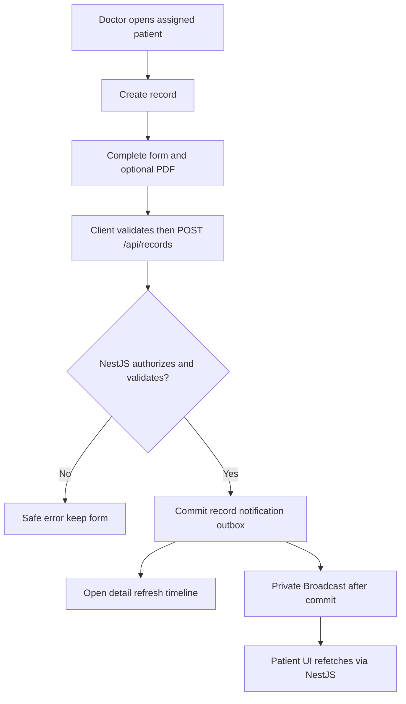
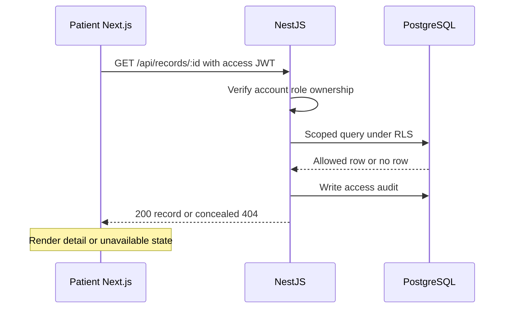
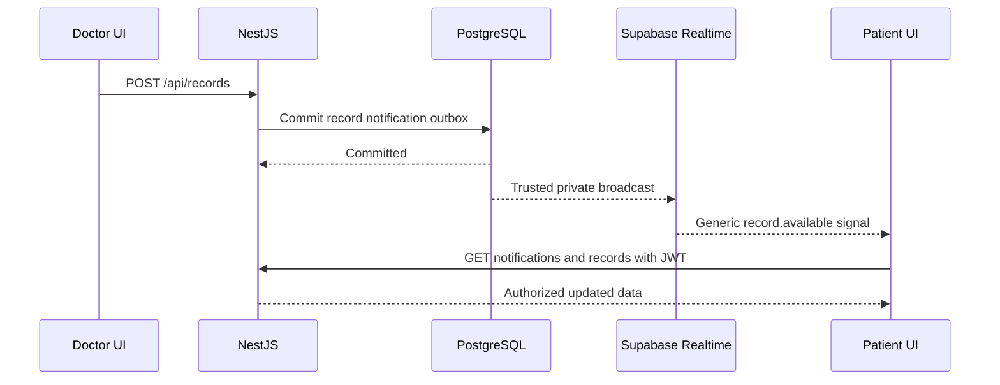

# 07 — Frontend UI/UX and Dashboard Design

**Project:** Patient Medical Records Management System (PMRMS)  
**Version:** 2.0 — 18 November 2026  
**Status:** Primary frontend implementation blueprint (highest-priority UI planning doc)  
**Related:** Documents `01`–`06` · Current Stage 0 page in `apps/web`

> **Purpose:** Specify pages, layouts, components, interaction logic, UI states and client security boundaries for one Next.js app with three role dashboards. NestJS remains the only clinical data authority. This document plans the UI — it does not claim screens are already built (except the Stage 0 connection workspace).

---

## 1. Why this document matters

The professor and demo partners judge PMRMS first by **what they see and can do in the browser**. Backend security is mandatory, but the frontend must:

1. Make each role’s job obvious in under 10 seconds  
2. Prove authorization visually (admin never sees diagnoses; patients never create records)  
3. Showcase the **medical timeline**, PDF download and conflict handling  
4. Handle loading / empty / error / 409 / realtime reconnect without confusion  
5. Stay responsive, keyboard-accessible and demo-ready  

| Layer | Choice | Role |
|---|---|---|
| App | Next.js 16 App Router + TypeScript | Routes, layouts, RSC shells |
| Style | Tailwind CSS 4 + CSS variables | Extend Stage 0 teal system |
| Primitives | Accessible UI kit (e.g. shadcn/ui) | Forms, dialogs, tables, toasts |
| Icons | Lucide | Consistent iconography |
| Server state | TanStack Query | Cache, retry, invalidation |
| Forms | React Hook Form + Zod | Field errors aligned with API DTOs |
| API | Typed `fetch` → `/api/*` proxy | Nest `/v1/*` (Document 06) |
| Realtime | `@supabase/supabase-js` | Private Broadcast wake-ups only |
| Charts | Recharts (or Chart.js) | Scoped diagnosis bars |
| Dates | `Intl.DateTimeFormat` | Display local; API stays UTC |

**Out of scope:** payments, Better Auth, Socket.IO, Supabase Auth, three separate frontend repos.

### 1.1 UX principles (non-negotiable)

| ID | Principle |
|---|---|
| UX-01 | One job per screen — one title, one primary action |
| UX-02 | NestJS authorizes; UI only reflects permissions |
| UX-03 | Never trust URL IDs — always refetch authorized data |
| UX-04 | Same safe copy for missing and unauthorized clinical IDs |
| UX-05 | Never put diagnoses in notifications, toasts titles, or page metadata |
| UX-06 | Every list has loading, empty, filtered-empty, and error |
| UX-07 | Forms preserve input on 400; disable double-submit |
| UX-08 | 409 conflicts never silent-overwrite |
| UX-09 | PDFs only via authenticated NestJS routes |
| UX-10 | Logout clears query cache, tokens in memory, and realtime joins |
| UX-11 | Mobile: drawer nav, stacked cards, ≥44px targets |
| UX-12 | Keyboard and screen-reader parity for timeline, tables, dialogs |

---

## 2. Role experience map

| Capability | Admin | Doctor | Patient |
|---|---|---|---|
| Dashboard | Ops overview | Clinical overview | Personal overview |
| Users / approvals / assignments | Yes | No | No |
| Security audit metadata | Yes | Own events optional | Own events optional |
| Patient demographics | Admin metadata only | Assigned | Own |
| Diagnoses / notes / PDFs | **Never by default** | Assigned | Own |
| Create / correct / archive records | No | Assigned | No |
| Diagnosis analytics | No | Scoped | Own summary optional |
| Notifications | Own | Own | Own |

**Visual proof for the professor**

- Admin shell has **no** “Medical records” or “PDF” nav items.  
- Patient shell has **no** “Create record” action.  
- Doctor shell only lists **assigned** patients.

Hiding a link is UX — NestJS + RLS still enforce every request.

---

## 3. Design system (extends Stage 0)

Stage 0 already uses a healthcare teal palette in `apps/web/app/globals.css`. Keep continuity:

| Token | Value | Use |
|---|---|---|
| `--background` | `#f5f7f8` | Page canvas |
| `--surface` | `#ffffff` | Panels / tables |
| `--ink` | `#152f36` | Primary text |
| `--muted` | `#536970` | Secondary text |
| `--border` | `#dce5e7` | Dividers |
| `--accent` | `#146b5b` | Primary actions / brand |
| `--accent-light` | `#e9f5ef` | Success / connected chips |
| `--pending` | `#805b19` | Warning / pending |
| `--danger` | `#b42318` | Errors / revoke |
| `--focus` | accent ring 3px | `:focus-visible` |

**Brand:** `PM+RMS` (accent on `+`), as on the foundation page.  
**Type:** one modern sans (replace Stage 0 Arial with a purposeful webfont when building dashboards — e.g. Source Sans 3 or IBM Plex Sans). Body 14–16px; page titles 24–30px desktop.  
**Density:** tables for admin/doctor lists; calmer cards for patient overview.  
**Dark mode:** optional, not MVP.

### 3.1 Layout chrome

```text
+--------+------------------------------------------+
| Brand  | Page title          [Bell] [Account ▾]   |
| Nav    +------------------------------------------+
|        | Breadcrumbs                               |
| Role   | Main content (max ~1280px)                |
| links  |                                           |
|        |                                           |
+--------+------------------------------------------+
```

- Desktop sidebar 240–264px; tablet collapses; mobile drawer.  
- Header: notification bell + unread badge + account menu (profile, logout).  
- Detail pages: breadcrumbs + `PageHeader` (title, short help, primary CTA).  
- Forms width ~640–760px for readability.

### 3.2 Primitive inventory

`AppShell` · `RoleSidebar` · `PageHeader` · `Breadcrumbs` · `StatCard` · `DataTable` · `Pagination` · `SearchInput` · `FilterBar` · `StatusBadge` · `EmptyState` · `ErrorState` · `LoadingSkeleton` · `ConfirmDialog` · `ConflictDialog` · `SessionExpiredDialog` · `FormField` · `NotificationBell` · `RecordTimeline` · `RecordCard` · `PdfActions` · `AccessDenied` · `RoleGate`

---

## 4. Information architecture

Protected layouts verify session + role before rendering. Route groups are **not** security.

### 4.1 Public

| Route | Page | Elements |
|---|---|---|
| `/` | Landing / Stage 0 workspace | Brand, short pitch, Login / Register, connection status (current) |
| `/login` | Login | Email, password, show/hide, submit, safe errors |
| `/register` | Patient registration | Name, birth date, email, password + confirm, consent note |
| `/doctor/apply` | Doctor application | Profile fields; clear “pending approval” outcome |
| `/unauthorized` | Denied | Safe copy + link home |
| `not-found` | 404 | Neutral return |

### 4.2 Admin (`/admin/*`)

| Route | Purpose |
|---|---|
| `/admin` | Counts: users, pending doctors, active assignments, recent security events |
| `/admin/users` | Search/filter, activate/suspend |
| `/admin/doctors` | Approve / reject pending doctors |
| `/admin/assignments` | Create / revoke doctor–patient links |
| `/admin/audit-logs` | Actor, action, outcome, requestId — **no diagnoses** |
| `/admin/notifications` | Own inbox |
| `/admin/profile` | Account + logout |

**No** `/admin/records`, **no** clinical detail routes.

### 4.3 Doctor (`/doctor/*`)

| Route | Purpose |
|---|---|
| `/doctor` | Assigned patients, recent records, unread notifications |
| `/doctor/patients` | Searchable assigned list |
| `/doctor/patients/[id]` | Demographics + authorized history + Create record |
| `/doctor/records` | Scoped list + filters |
| `/doctor/records/new` | Create form (+ optional PDF) |
| `/doctor/records/[id]` | Detail + PDF + Edit/Archive if allowed |
| `/doctor/records/[id]/edit` | Correction + `expectedVersion` + 409 dialog |
| `/doctor/analytics` | Scoped diagnosis bar chart + data table |
| `/doctor/notifications` | Inbox |
| `/doctor/profile` | Profile + logout |

### 4.4 Patient (`/patient/*`)

| Route | Purpose |
|---|---|
| `/patient` | Record count, latest visit, unread notifications |
| `/patient/records` | **Timeline / list toggle**, filters, PDF badges |
| `/patient/records/[id]` | Read-only detail + PDF preview/download |
| `/patient/profile` | Editable permitted demographics |
| `/patient/notifications` | Own inbox |

**No** create/edit clinical routes for patients.

### 4.5 Post-login routing logic

```text
GET /auth/me → role + status
  SUSPENDED / PENDING clinical → safe message / limited shell
  ADMIN   → /admin
  DOCTOR  → /doctor   (if verification ≠ APPROVED: banner “Awaiting approval”)
  PATIENT → /patient
Wrong role URL → /unauthorized (do not leak clinical payloads)
```

---

## 5. Screen specifications (demo-critical)

### 5.1 Login & registration

**Login**

- Fields: email, password (show/hide), Submit.  
- Client validation for empty/format; server enforces auth.  
- Errors: generic “Invalid email or password.” — no enumeration.  
- Suspended: actionable safe message.  
- Disable button while submitting; single-flight refresh later for 401s.  
- Success → role dashboard.

**Patient register**

- Name, birth date, email, password, confirmation.  
- Zod schema mirrors `RegisterPatientDto`.  
- Success → login or signed-in session per backend policy.

**Doctor apply**

- Explicit copy: “Your account stays pending until an administrator approves you.”  
- Never unlock clinical nav on apply alone.

**Session storage**

- Access token in **memory** (or agreed BFF cookie pattern).  
- Refresh in HttpOnly cookie.  
- **No** medical bearer tokens in `localStorage`.

### 5.2 Admin dashboard

**Stats:** active users · pending doctors · active assignments · recent security events (counts only).  
**Panels:** pending approval queue · recent admin activity · shortcut to assignments.  
**Empty:** “No doctor approvals are waiting.”  
**Forbidden content:** diagnoses, timelines, PDF links, clinical search.

### 5.3 Doctor approvals

| Column | Content |
|---|---|
| Name | Doctor full name |
| Email | Account email |
| Applied | Application date |
| Status | Pending / Approved / Rejected badge |
| Actions | Approve · Reject |

Approve → confirm dialog. Reject → short admin reason (non-sensitive). Refresh list after mutation. Already-resolved rows show conflict, not silent re-approve.

### 5.4 Assignments

```text
[ Search approved doctor ▾ ]   [ Search patient ▾ ]   [ Assign ]
---------------------------------------------------------------
Doctor          Patient         Assigned        Actions
Dr. Example     Aline Test      2026-03-01      [Revoke]
```

- Confirm both names before submit.  
- Revoke warning: “This doctor will lose access to this patient’s records.”  
- Soft-revoke only — history remains.  
- `409` on duplicate ACTIVE pair → clear message.

### 5.5 Doctor dashboard

**Cards:** assigned patients · authorized records · recent creates · unread notifications.  
**Below:** recent activity feed + patient preview.  
Counts **only** inside ACTIVE assignments. Click patient → `/doctor/patients/[id]`.

### 5.6 Assigned patients list

Paginated table: name, birth date (if permitted), assigned date, last record date, View.  
Debounced search; query change resets `page` to 1.  
Empty copy distinguishes “No assigned patients” vs “No matches for this search.”

### 5.7 Create medical record (primary doctor task)

```text
+-----------------------------------------------------+
| New medical record                      [Cancel]     |
| Patient *        [Assigned patient only ▾]          |
| Diagnosis *      [___________________________]      |
| Record date *    [YYYY-MM-DD]                       |
| Clinical notes   [                           ]      |
|                  [                           ]      |
| PDF report       [Choose PDF]  PDF · max 10 MiB     |
|                                                     |
|                         [Save medical record]       |
+-----------------------------------------------------+
```

Rules:

1. Patient selector = ACTIVE assignments only (prefill when opened from patient page).  
2. Diagnosis required, trimmed, max length = API.  
3. Date required; enforce policy bounds.  
4. Notes optional, bounded.  
5. PDF optional; content-type + size checks before upload.  
6. Cancel / Save; spinner; field errors; success toast → detail page.  
7. Block double-submit.  
8. If record create and file upload are separate calls, show independent success/failure and allow file retry.  
9. Never claim upload success without server confirmation.

### 5.8 Records list

**Doctor columns:** Patient · Diagnosis · Date · Author · PDF · Status · View  
**Patient columns:** Diagnosis · Doctor · Date · PDF · View  

Filters: diagnosis text, from/to dates, patient (doctor only). Sort newest first.  
**Never** download the world and filter in the browser — every request is scoped by NestJS.

### 5.9 Medical timeline (flagship patient/doctor feature)

Primary interactive showcase for the academic demo.

```text
Medical history                         [Timeline | List]
Search [____________]   From [date]  To [date]  [Clear]

2026
  ● 18 Nov — Example diagnosis
  |          Dr. Example              [Details] [PDF]
  |
  ● 03 Oct — Follow-up visit
  |          Dr. Example              [Details]
  |
2025
  ● 21 Dec — Previous consultation
             Dr. Example              [Details] [PDF]
```

**Logic**

- Order by `recordDate DESC`, then `id DESC`.  
- Group by month/year when helpful.  
- Each entry: date, diagnosis, doctor name, short notes preview (if authorized), PDF badge, Details.  
- Semantic list + real buttons/links (not decorative-only SVG).  
- Keyboard navigable; color not the only cue.  
- List mode for narrow screens / SR users.  
- Realtime signal → invalidate queries + subtle “New information available” if user is mid-read.  
- Empty: “No medical records are available yet.”  
- Changing URL to another patient’s id → same unavailable state as missing.

### 5.10 Record detail

Show: diagnosis, record date, doctor, patient (doctor view), notes, status, timestamps, version, file meta if authorized.  
Doctor: Edit / Archive when assignment + policy allow. Patient: read-only.  
Back link returns to the prior authorized list.

**PDF:** `Preview` and `Download` via NestJS. Use blob URL for in-session preview; revoke on close/unmount; `Cache-Control` respectful; never embed public R2 URLs or show object keys.

### 5.11 Correction + 409 conflict

Form loads current `version` as `expectedVersion`. On `409`:

> “This record was changed by another user. Your changes were not saved. Reload the latest version before trying again.”

Actions: **Reload current record** · **Cancel**.  
May keep local draft in memory with clear warning that reload discards it.  
**No** force-overwrite in MVP.

### 5.12 Diagnosis analytics (doctor)

- Total authorized ACTIVE records.  
- Horizontal bar chart: records per diagnosis (scoped).  
- Accessible data table under chart.  
- Empty: “Not enough records to display.”  
- No organization-wide totals for ordinary doctors.  
- Patient may see a simple personal count on overview — no separate analytics MVP page required.

### 5.13 Notifications

- Header bell + unread badge.  
- Dropdown: latest generic items.  
- Full inbox: kind, time, read state, open action.  
- Mark read → `PATCH /api/notifications/:id/read` (own only).  

Example copy:

> “A new medical record is available. Open your medical history to view it.”

Forbidden in UI chrome / Broadcast / push previews: diagnosis text, notes, PDF names as clinical spoilers, signed URLs.

---

## 6. UI state machine (every data screen)

| State | Behavior |
|---|---|
| Initial loading | Skeletons — no empty flash |
| Background refetch | Keep prior safe data + subtle indicator |
| Empty | Explain why + next authorized action |
| Filtered empty | “No matches” + Clear filters |
| 400 validation | Inline field errors; keep input |
| 401 | One controlled refresh; else login + clear private cache |
| 403 | Permission denied — no clinical detail |
| 404 clinical | “Record not found or unavailable” |
| 409 | Conflict dialog — no silent overwrite |
| 429 | Polite retry; no login hammering |
| Network / 5xx | Retry; keep draft if safe |
| PDF error | Safe message; no storage paths |
| Realtime down | Do not claim “live”; refetch on reconnect |
| Success | Toast / inline confirm + navigate when useful |

Never toast stack traces, SQL, tokens, R2 keys, or unexpected PHI.

---

## 7. API integration (this monorepo)

Browser uses **same-origin** `/api/...` which Next rewrites to Nest `/v1/...`.

| UI action | Browser request |
|---|---|
| Login | `POST /api/auth/login` |
| Me | `GET /api/auth/me` |
| Realtime token | `POST /api/auth/realtime-token` |
| My patient profile | `GET /api/patients/me` |
| Assigned patients | `GET /api/patients` |
| Patient timeline | `GET /api/patients/:id/records` |
| Records list | `GET /api/records` |
| Create record | `POST /api/records` |
| Record detail | `GET /api/records/:id` |
| Edit record | `PATCH /api/records/:id` |
| Archive | `PATCH /api/records/:id/archive` |
| Upload PDF | `POST /api/records/:id/files` |
| Download PDF | `GET /api/records/:id/download` or `.../files/:fileId/download` |
| Analytics | `GET /api/analytics/diagnoses` |
| Notifications | `GET /api/notifications` |
| Mark read | `PATCH /api/notifications/:id/read` |
| Admin ops | `/api/admin/...` (Document 06) |

### 7.1 Typed API client rules

- Base = same origin `/api` (or env for non-proxied tooling).  
- Attach `Authorization: Bearer <access>`.  
- Single-flight refresh on 401; fail closed after one retry.  
- Normalize errors to `ApiError { statusCode, code, message, requestId }`.  
- Credentials/CORS match `WEB_ORIGIN` / cookie policy from Document 05.  
- Do not persist clinical response bodies in `localStorage`, analytics, or public error trackers.

### 7.2 Query keys

```text
['me']
['patients', filters]
['patient', id]
['records', filters]
['record', id]
['notifications', filters]
['diagnoses', filters]
['admin-users', filters]
['admin-assignments', filters]
['audit-logs', filters]
```

Invalidate after mutations and realtime wake-ups.  
Clear **all** private caches on logout / forced re-login.  
No disk persistence of medical caches. No SSG of patient-specific pages.

### 7.3 Realtime client flow

```text
1. NestJS login OK
2. POST /api/auth/realtime-token
3. supabase.realtime.setAuth(token)
4. Subscribe private topic user:<sub>
5. On event → invalidate notifications/records queries
6. Refetch via NestJS (event is not clinical data)
7. On reconnect / token refresh → rejoin + refetch durable state
8. On logout → unsubscribe immediately
```

If NestJS is cold while Realtime is live, show loading/retry — **do not** pretend the record is loaded until REST succeeds.

---

## 8. Suggested `apps/web` structure

```text
apps/web/
├── app/
│   ├── (public)/
│   │   ├── page.tsx                 # landing + Stage 0 connection (exists)
│   │   ├── login/page.tsx
│   │   ├── register/page.tsx
│   │   └── doctor/apply/page.tsx
│   ├── (protected)/
│   │   ├── admin/...
│   │   ├── doctor/...
│   │   └── patient/...
│   ├── unauthorized/page.tsx
│   ├── not-found.tsx
│   ├── layout.tsx
│   └── globals.css                  # design tokens (exists)
├── components/
│   ├── layout/   ui/   records/   patients/   admin/
│   ├── notifications/   charts/
├── features/
│   ├── auth/   records/   patients/   admin/
│   ├── notifications/   analytics/
├── lib/
│   ├── api-client.ts
│   ├── auth-session.ts
│   ├── realtime-client.ts
│   ├── query-client.ts
│   └── utils.ts
└── types/
    ├── api.ts   auth.ts   records.ts
```

RSC for safe shells; Client Components for forms, tables, timeline, bell, realtime.

Shared Zod types grow in `packages/contracts` alongside API DTOs.

---

## 9. Journey diagrams

### 9.1 Doctor creates a record



### 9.2 Patient opens a record



### 9.3 Realtime wake-up



---

## 10. Accessibility & privacy checklist

- Heading order, labeled inputs, accessible dialogs, error summaries.  
- Visible `:focus-visible`; keyboard sidebar, row actions, timeline, PDF controls.  
- WCAG AA contrast; status never by color alone.  
- Live regions for loading/toasts where helpful.  
- Chart always paired with a data table.  
- No PHI in document title, OG tags, analytics, or browser push bodies.  
- Revoke PDF object URLs; avoid long-lived local PDF caches.  
- Session expiry clears protected UI state; back button must not resurrect confidential views from bfcache when avoidable.  
- Demo data remains fictional.

---

## 11. Frontend acceptance tests

| ID | Scenario | Expected |
|---|---|---|
| UI-01 | Login admin | Admin shell; no clinical records nav |
| UI-02 | Login approved doctor | Doctor dashboard scoped data |
| UI-03 | Login patient | Own history only |
| UI-04 | Patient opens foreign record URL | Same unavailable state as missing |
| UI-05 | Create form, zero assignments | Disabled/empty guidance |
| UI-06 | Invalid create submit | Inline errors; nothing created |
| UI-07 | Valid create | Success → detail; lists update |
| UI-08 | Patient timeline | Chronological, filters work |
| UI-09 | Authorized PDF download | Valid PDF; Network shows NestJS call |
| UI-10 | Unauthorized PDF | No file; safe error |
| UI-11 | Stale edit | 409 dialog; no lost update |
| UI-12 | New record notification | Bell updates; no diagnosis in event UI |
| UI-13 | Realtime reconnect | Durable refetch |
| UI-14 | Admin revokes assignment | Doctor next REST fails; UI refreshes |
| UI-15 | Session expiry | Relogin; private cache cleared |
| UI-16 | Slow / empty / error | Distinct skeletons, empty, retry |
| UI-17 | Mobile viewport | Usable nav and stacked content |
| UI-18 | Keyboard only | Forms, dialogs, timeline operable |
| UI-19 | Unapproved doctor | No clinical create; pending banner |
| UI-20 | Admin URL guess `/doctor/records` | Unauthorized — no clinical payload |

Use Playwright for journeys; React Testing Library for components. UI tests **do not** replace NestJS/RLS tests in Document 06.

---

## 12. Frontend implementation milestones

| # | Milestone | Deliverable |
|---|---|---|
| F0 | Foundation (done) | Connection workspace, tokens, Tailwind |
| F1 | Shell + auth | AppShell, login/register, `/auth/me` routing, logout |
| F2 | Admin | Users, approvals, assignments, audit list |
| F3 | Doctor core | Patients, records list/create/detail |
| F4 | Patient core | Dashboard, **timeline**, detail, PDF |
| F5 | Edit + conflict | Edit form, 409 dialog, archive |
| F6 | Analytics + inbox | Chart, bell, notifications page |
| F7 | Realtime | Private channel, invalidate, reconnect |
| F8 | Quality | Responsive, a11y, all UI states, Playwright |
| F9 | Demo polish | Seeded accounts, Network evidence, conflict + PDF demos |

Build order should follow doctor create → patient timeline → PDF → 409 → admin revoke — the story the professor will walk through.

---

## 13. Definition of done

- [ ] Public + protected routes work for ADMIN, DOCTOR, PATIENT  
- [ ] Nav reflects permissions without replacing server checks  
- [ ] All clinical views load only via authorized `/api/*` → NestJS  
- [ ] Timeline, filters, create form, detail, PDF preview/download work  
- [ ] Loading, empty, 400, 401, 403, concealed 404, 409, network states are clear  
- [ ] Admin cannot reach clinical record content by default  
- [ ] No public PDF URL or object key in the UI  
- [ ] Inbox persists; realtime only triggers safe refetch  
- [ ] Reconnect + session expiry handled  
- [ ] Responsive + keyboard verified  
- [ ] Demo users and records stay fictional  
- [ ] Design tokens stay consistent with Stage 0 brand  

---

**Next:** `08-testing-deployment-and-academic-presentation.md`.  
**Then implement** frontend milestones F1→F9 against Documents 05–07, with NestJS endpoints from Document 06.
