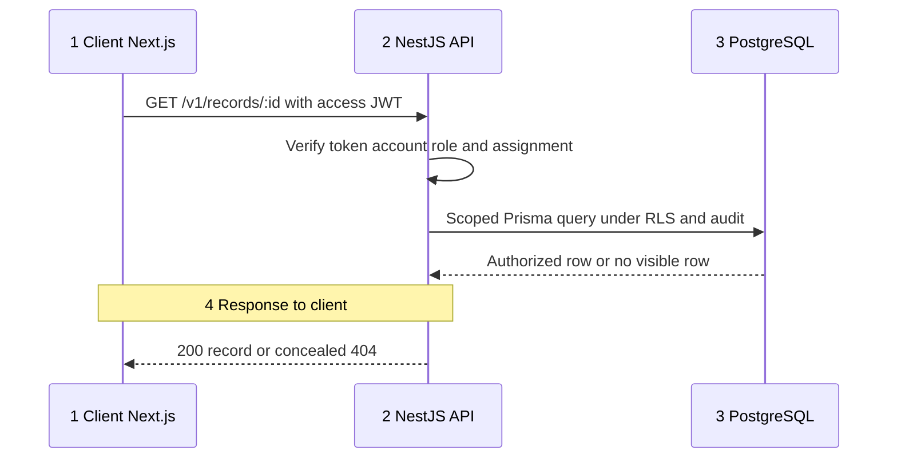

# 08 — Testing, Deployment and Academic Presentation

**Project:** Patient Medical Records Management System (PMRMS)  
**Student:** Claude Iranzi · **ID:** 223005124  
**Version:** 2.0 — 18 November 2026  
**Status:** Assessment, verification and demonstration plan  
**Related:** Documents `01`–`07`

> **Purpose:** Define how PMRMS is verified, deployed and presented. Only fictional patients, synthetic diagnoses and generated PDFs are used. This academic prototype is not certified for real clinical data.

---

## 1. System under test

| Concern | Implementation |
|---|---|
| Actors | Administrator, Doctor, Patient |
| Frontend | Next.js App Router, TypeScript, Tailwind CSS |
| Backend | NestJS REST API under `/v1` (browser via Next `/api` proxy) |
| Authentication | Custom NestJS JWT + rotating refresh sessions (Argon2id) |
| Database | PostgreSQL + Prisma 7 (local `pmrms`; Supabase-hosted for demo) |
| Authorization | NestJS guards + ownership/assignment checks + PostgreSQL RLS |
| Realtime | Supabase private Broadcast (no NestJS WebSocket server) |
| Files | Private Cloudflare R2 via authorized NestJS endpoints |
| Audit | `access_logs` for allowed and denied clinical attempts |
| Concurrency | Optimistic locking (`records.version`) → HTTP `409` |
| Tests | Jest + Supertest (+ RLS integration); Playwright for UI |
| API docs | Swagger `/docs` + README curl examples |

**Stack note:** NestJS/JWT and Cloudflare R2 provide the assessed behaviours of authentication, row protection and private file delivery. Prisma accesses PostgreSQL through NestJS; the browser uses NestJS for clinical data and may use Supabase only for private Realtime subscriptions.

---

## 2. Traceability to assessment requirements

| Requirement | Design location | Evidence |
|---|---|---|
| Patients (`name`, `birth_date`) and records (`patient_id`, `doctor_id`, `diagnosis`, file reference) | Document 04 — `patients`, `records`, `medical_files.object_key` / optional `records.file_url` | ERD, migration, table screenshots |
| PK, FK, NOT NULL | Prisma schema + SQL checks | Schema + constraint tests |
| ≥10 sample rows | Deterministic seed | Seed output + DB rows |
| Row Level Security | Restricted runtime role + policies | Cross-user DB integration test |
| Private storage | Cloudflare R2 private bucket | Bucket settings + denied anonymous access + authorized download |
| GET / POST / PATCH (no routine hard DELETE) | Document 06 NestJS routes | Swagger + curl |
| Patients access only own records | JWT + ownership + RLS | Patient A vs B test |
| Log record access | `access_logs` | Success and DENIED rows |
| `400` invalid / `404` missing or concealed | Validation + exception mapping | Automated + curl tests |
| Records per diagnosis | `GET /v1/analytics/diagnoses` | JSON + doctor chart |
| List, create, detail UI | Document 07 dashboards | Live browser demo |
| Timeline + PDF download | Patient/doctor UI + NestJS stream | Open/download PDF |
| Loading / empty / error states | Document 07 state machine | Live UI |
| Authentication and roles | Document 05 | Login, denial, expiry tests |
| Four-step whiteboard | Client → NestJS → PostgreSQL → response | Live explanation |
| Partner curl from README | Seeded accounts + commands | Independent partner run |
| URL ID swap attack | Concealed `404 RECORD_UNAVAILABLE` + audit | Demo + screenshot |
| NestJS talks to PostgreSQL; Realtime separate | Architecture Documents 03–05 | Network tab + DB evidence |
| Two simultaneous editors | Version check | Two sessions, one `409` |
| Eight backend tests | §5 | Passing test report |
| Realtime + concurrency | Private Broadcast + optimistic lock | Live event + `409` |
| Deployed demo | HTTPS frontend + API | Live URLs |

---

## 3. Demo-ready release criteria

A build is ready for academic demonstration when:

1. Constraints and RLS are verified on the **same** runtime DB role NestJS uses.  
2. Admin approval and doctor–patient assignment workflows work.  
3. Login, refresh and logout work with documented credential handling.  
4. Patients cannot read other patients’ records by changing IDs.  
5. Doctors create records only for ACTIVE assigned patients.  
6. Administrators have **no** default clinical read access.  
7. Private PDF upload/download works with authorization and audit evidence.  
8. Diagnosis analytics stay within authorized scope.  
9. The eight mandatory backend tests pass; critical security tests also pass.  
10. Concurrent edits cannot silently lose data.  
11. Realtime delivers generic private events; reconnect refetches durable state.  
12. A second person can follow the README curl kit successfully.  
13. Frontend and API are reachable over HTTPS with fictional data only.

---

## 4. Environments and fixtures

| Environment | Use |
|---|---|
| Local | Development (`pmrms` database, `pnpm dev`) |
| Automated test | Isolated DB + test/mock R2 — never destructive against demo |
| Demo | Hosted frontend, API, PostgreSQL, private R2 — synthetic data only |

### 4.1 Seeded demo accounts

| Account | Role / status | Purpose |
|---|---|---|
| `admin.demo@example.test` | ADMIN / ACTIVE | Approvals and assignments |
| `doctor.a@example.test` | DOCTOR / ACTIVE / APPROVED | Primary clinical demo |
| `doctor.b@example.test` | DOCTOR / ACTIVE / APPROVED | Concurrent edit partner |
| `doctor.pending@example.test` | DOCTOR / PENDING | Approval denial |
| `patient.a@example.test` | PATIENT / ACTIVE | Own records |
| `patient.b@example.test` | PATIENT / ACTIVE | Cross-patient denial |

Seed ≥10 fictional patients, ≥10 records, ACTIVE assignments, and at least one generated PDF. For concurrency, assign **Doctor A and Doctor B** to the same patient. Publish exact demo IDs via seed output / README. Passwords come from local seed environment configuration — never commit production secrets.

---

## 5. Backend tests

### 5.1 Mandatory eight (Jest + Supertest)

| ID | Scenario | Expected |
|---|---|---|
| BE-01 | Valid login | `200`, access JWT, safe user summary |
| BE-02 | `GET /v1/records` without token | `401` |
| BE-03 | Patient A reads own record | `200` |
| BE-04 | Patient A reads Patient B record | Concealed `404` + durable `DENIED` audit |
| BE-05 | Approved assigned doctor creates record | `201`, trusted `doctorId`, row persisted |
| BE-06 | Invalid create payload | `400`, no row |
| BE-07 | Valid UUID, absent record | `404` |
| BE-08 | Two PATCH with same `expectedVersion` | One `200`, one `409` |

### 5.2 Recommended security tests

| ID | Scenario | Expected |
|---|---|---|
| SEC-01 | Patient `POST /v1/records` | `403` |
| SEC-02 | Unapproved doctor clinical call | Denied |
| SEC-03 | Unassigned doctor record access | Concealed `404` + audit |
| SEC-04 | Admin clinical diagnosis read | Denied by API and RLS |
| SEC-05 | Assignment revoked; doctor retries | Denied immediately |
| SEC-06 | Patient downloads another PDF | Concealed `404`; no bytes |
| SEC-07 | Non-PDF upload | Rejected |
| SEC-08 | Anonymous R2 object access | Denied |
| SEC-09 | Refresh token reuse after rotation | Rejected / family revoked |
| SEC-10 | Suspended user with unexpired JWT | Denied after status check |
| SEC-11 | Client-supplied `doctorId` | Ignored/rejected |
| SEC-12 | Foreign notification access | Denied |
| SEC-13 | Diagnosis analytics | Authorized scope only |
| SEC-14 | Foreign Realtime topic subscribe | Cannot receive protected events |
| SEC-15 | Runtime role without actor context | RLS denies rows |
| SEC-16 | DB fail after R2 upload | Orphan cleanup / reconciliation |
| SEC-17 | Audit path on denial | Denial not silently lost |
| SEC-18 | Missed Broadcast then reconnect | Inbox/timeline recovered via REST |

RLS is proven only with the **restricted NestJS runtime role**, not a database owner or `BYPASSRLS` connection.

### 5.3 Example assertion (illustrative)

```ts
it('conceals another patient record and logs denial', async () => {
  const response = await request(app.getHttpServer())
    .get(`/v1/records/${patientBRecordId}`)
    .set('Authorization', `Bearer ${patientAToken}`)
    .expect(404);

  expect(response.body.code).toBe('RECORD_UNAVAILABLE');
  const audit = await findAuditForAttempt({
    actorUserId: patientAUserId,
    resourceId: patientBRecordId,
    outcome: 'DENIED',
  });
  expect(audit).toBeDefined();
});
```

---

## 6. Concurrency demonstration

```text
Doctor A reads record R, version = 3
Doctor B reads record R, version = 3
Doctor A PATCH { expectedVersion: 3, ... }  → 200, version = 4
Doctor B PATCH { expectedVersion: 3, ... }  → 409 RECORD_VERSION_CONFLICT
Doctor B reloads and sees version 4
```

UI message: **“This record was updated by someone else. Refresh before editing.”**  
No silent overwrite. Winner’s diagnosis is retained; a revision row records the change.

---

## 7. Frontend verification (Playwright)

| ID | Journey | Visible result |
|---|---|---|
| UI-01 | Patient login | Patient shell and navigation |
| UI-02 | Admin login | Admin shell; no clinical charts |
| UI-03 | Approve doctor + assign patient | Confirmations; doctor gains access |
| UI-04 | Doctor creates record | Validation, success, list updates |
| UI-05 | Patient timeline | Chronological authorized entries |
| UI-06 | PDF open/download | Authenticated NestJS download |
| UI-07 | Search/filter | Correct results and empty state |
| UI-08 | Invalid form | Inline errors; no mutation |
| UI-09 | Pending request | Skeleton / loading |
| UI-10 | Zero results | Helpful empty state |
| UI-11 | API unavailable | Retry state; no false success |
| UI-12 | Foreign record URL | Unavailable message; no leak |
| UI-13 | Concurrent edit | `409` dialog; reload shows winner |
| UI-14 | Realtime event | Bell/inbox updates; REST refetch |
| UI-15 | Realtime reconnect | Durable notifications restored |
| UI-16 | Logout + back | No confidential content |
| UI-17 | Mobile viewport | Usable navigation and forms |
| UI-18 | Keyboard only | Menus, dialogs, timeline operable |

Sensitive API responses must not be placed in shared public caches. Realtime UI copy stays generic — no diagnoses in browser notification titles.

---

## 8. Realtime verification

Private Broadcast only, with NestJS-issued short-lived Supabase-compatible tokens and `realtime.messages` policies.

1. Patient A receives a generic `record.available` signal after commit.  
2. Patient B cannot receive Patient A’s events.  
3. Unauthenticated clients cannot join protected topics.  
4. After disconnect/reconnect, REST restores the notification inbox.  
5. Revoked doctors are blocked on the next REST call; token lifetime limits stale subscriptions.  
6. Payloads exclude diagnoses, notes, DOB, object keys and signed URLs.  
7. Events publish **after** successful commit.

If the NestJS host is cold, the UI shows loading/retry while Realtime may still be connected. Event delivery uses a database-triggered Broadcast or an external publisher — not an in-process timer that stops when the API sleeps.

---

## 9. Cloudflare R2 verification

- Bucket is private (no public list/read).  
- Object keys are randomized; DB stores private metadata only.  
- Uploads validate PDF content, MIME and size.  
- Only authorized doctors upload to permitted records.  
- Downloads require NestJS ownership/assignment checks.  
- Anonymous, foreign patient and unassigned doctor attempts return no PDF bytes.  
- Attempts are audited; credentials never appear in responses.  
- Optional signed URLs are short-lived bearer capabilities — never stored permanently.  
- After revocation, new authorized downloads fail.

---

## 10. Deployment

### 10.1 Service placement

| Service | Host | Notes |
|---|---|---|
| Next.js | Vercel (or equivalent) | Configure production origin |
| NestJS | Node.js HTTPS host | Expect possible cold starts on free tiers |
| PostgreSQL + Realtime | Supabase project | Protect secrets; verify limits |
| PDFs | Cloudflare R2 private bucket | Scoped credentials; orphan cleanup |
| Event delivery | DB-triggered Broadcast or scheduled worker | Independent of NestJS process uptime |

### 10.2 Environment variables (names only)

**API (server-only)**

```dotenv
NODE_ENV=production
API_HOST=0.0.0.0
API_PORT=3001
DATABASE_URL=
DIRECT_URL=
JWT_PRIVATE_KEY=
JWT_PUBLIC_KEY=
JWT_KEY_ID=
REFRESH_TOKEN_PEPPER=
WEB_ORIGIN=https://<frontend-domain>
API_ORIGIN=https://<api-domain>
R2_ACCOUNT_ID=
R2_BUCKET=
R2_ACCESS_KEY_ID=
R2_SECRET_ACCESS_KEY=
SUPABASE_URL=
REALTIME_JWT_SIGNING_CONFIG=
```

**Frontend (public values only)**

```dotenv
NEXT_PUBLIC_API_BASE_URL=https://<api-domain>
NEXT_PUBLIC_SUPABASE_URL=https://<project-ref>.supabase.co
NEXT_PUBLIC_SUPABASE_PUBLISHABLE_KEY=
```

Never place JWT signing material, R2 secrets, database passwords or privileged Supabase keys in `NEXT_PUBLIC_*` variables. Local development continues to use the root `.env` and Next rewrite to `/v1`.

### 10.3 Deployment sequence

1. Provision demo Supabase, R2 bucket and hosts — synthetic data only.  
2. Apply reviewed migrations; enable RLS; confirm restricted runtime role.  
3. Seed accounts, assignments, records and a test PDF.  
4. Configure API secrets, CORS (`WEB_ORIGIN`), JWT and R2; deploy NestJS.  
5. Verify `/v1/health`, `/docs`, authentication and scoped queries.  
6. Configure Realtime token trust and private-topic policies; test allow/deny.  
7. Deploy Next.js; verify login, records, PDF and notifications.  
8. Run full automated tests against an isolated test database; smoke-test demo.  
9. Record HTTPS URLs, commit hash and passing test evidence in the presentation pack.

### 10.4 Rollback

Prefer backward-compatible migrations. Keep a restore path for demo data. If authorization or private PDF access regresses, disable the affected route rather than leave it exposed.

---

## 11. Network and database evidence

**Doctor opens a record**

1. Sign in as approved, assigned Doctor A.  
2. DevTools → Network (Fetch/XHR).  
3. Open record detail.  
4. Show `GET /v1/records/<id>` → `200` with sanitized body.  
5. Explain: the browser does not hold DB credentials; NestJS/Prisma query PostgreSQL.  
6. Show the fictional row and a `SUCCESS` `access_logs` entry.  
7. Repeat with Patient B’s token → `404 RECORD_UNAVAILABLE` + `DENIED` audit.  
8. Optionally show the Realtime WebSocket with **generic** notification payloads only.

Table Editor screenshots prove stored data; a restricted-role integration test proves RLS. Redact tokens and secrets in all screenshots.

---

## 12. Whiteboard trace (four steps)



**Explanation:** The doctor selects a record in Next.js. The browser sends the access JWT to NestJS. NestJS verifies identity and the ACTIVE assignment. PostgreSQL applies RLS while Prisma reads the row. NestJS writes an audit entry and returns only an authorized response. R2 is used only if a PDF download is requested.

---

## 13. Security demonstration — URL ID change

Patient A changes the detail URL from an owned record id to Patient B’s id.

**Expected**

- NestJS returns `404` with `RECORD_UNAVAILABLE` (same copy as a missing record).  
- UI shows “Record not found or unavailable.”  
- A `DENIED` audit row is stored (actor, resource, timestamp, request id).  
- No diagnosis, PDF or foreign demographics appear.

**Evidence:** own-record `200` · foreign-id `404` · UI state · matching audit row · automated assertion that private fields are absent.

Operation-level denials (e.g. patient creating a record) may return `403`.

---

## 14. Partner curl exercise

```bash
export API="http://127.0.0.1:3001/v1"

curl -i "$API/health"

curl -i -X POST "$API/auth/login" \
  -H "Content-Type: application/json" \
  -d '{"email":"patient.a@example.test","password":"<local-demo-password>"}'

export TOKEN="<paste-access-jwt>"
curl -i "$API/records" -H "Authorization: Bearer $TOKEN"

export RECORD_ID="<seeded-owned-record-uuid>"
curl -i "$API/records/$RECORD_ID" -H "Authorization: Bearer $TOKEN"

curl -i "$API/records/not-a-uuid" -H "Authorization: Bearer $TOKEN"
curl -i "$API/records/99999999-9999-4999-8999-999999999999" \
  -H "Authorization: Bearer $TOKEN"
```

Also run one unauthorized cross-patient lookup using seeded IDs. README documents expected status codes. Do not commit tokens or real passwords.

| Check | Result |
|---|---|
| Partner followed README independently | ☐ |
| Login returned access token | ☐ |
| Authorized record → `200` | ☐ |
| Invalid UUID → `400` | ☐ |
| Unknown UUID → `404` | ☐ |
| Cross-patient access blocked (`404` + audit) | ☐ |
| Swagger matches runtime behaviour | ☐ |

---

## 15. Presentation outline (8–12 minutes)

| Slide | Topic | Show |
|---|---|---|
| 1 | Problem and objectives | Why authorized digital records matter |
| 2 | Actors and permissions | Admin / Doctor / Patient matrix |
| 3 | Architecture | Next.js → NestJS → PostgreSQL; R2; Realtime |
| 4 | Data model | ERD, constraints, sample rows |
| 5 | Security model | JWT, RBAC, RLS, private PDFs, audit |
| 6 | Doctor journey | Assignment → create → PDF |
| 7 | Patient journey | Timeline → detail → download |
| 8 | Attack demo | URL ID swap → concealed 404 + audit |
| 9 | Realtime + concurrency | Notification; `409` conflict |
| 10 | Tests and deployment | Passing tests; HTTPS URLs |

**Live demo order**

1. Admin approves doctor and assigns patient.  
2. Doctor A creates a record and attaches a PDF.  
3. Patient receives a generic notification and refreshes the timeline.  
4. Patient A opens and downloads their PDF.  
5. Patient A attempts Patient B’s record → concealed 404 + audit.  
6. Doctors A and B edit the same record → one `409`; version preserved.  
7. Show diagnosis analytics, test report and live URLs.

If time is short, prioritize authorization, audit evidence and the eight backend tests.

---

## 16. Anticipated questions

**Why NestJS?**  
TypeScript end-to-end with modular REST APIs, guards, validation, OpenAPI and automated tests.

**Why custom JWT instead of hosted auth?**  
NestJS remains the identity and clinical authorization authority. Realtime uses a separately issued, short-lived token verified by Supabase policies.

**Why Supabase with Prisma?**  
Supabase hosts PostgreSQL and managed Realtime. Prisma is the application ORM inside NestJS. The browser does not query clinical tables through Supabase.

**Where is RLS enforced?**  
In PostgreSQL under a restricted runtime role with transaction-scoped actor context, in addition to NestJS checks.

**Can an admin read diagnoses?**  
No. Admin manages accounts and assignments only; clinical read is denied by default.

**How does a patient learn about a new record?**  
The record and notification are persisted; a private Broadcast signals the UI to refetch authorized data from NestJS.

**What if the API host sleeps?**  
Realtime may stay connected to Supabase, but clinical REST can be delayed. The UI shows loading/retry; missed events are recovered from PostgreSQL.

**Why Cloudflare R2?**  
Private object storage with NestJS-controlled authorization and streaming; the database stores object metadata, not public links.

**What happens on concurrent edits?**  
Conditional updates on `version` allow one writer to succeed; the other receives `409` and must reload.

**How is IDOR prevented?**  
Verified identity, ownership/assignment checks and RLS; unauthorized clinical IDs return a concealed `404` and are audited.

**Do eight tests prove production healthcare security?**  
They demonstrate academic acceptance criteria. Real clinical systems require broader privacy, security and compliance controls.

---

## 17. Evidence pack

Collect demonstration artefacts **without secrets or real PHI**:

| Item | Content |
|---|---|
| ERD / constraints | Schema screenshot |
| Seed data | ≥10 patients and records |
| Login | Redacted JWT response |
| Doctor create | Record + optional PDF |
| Patient timeline | Chronological UI |
| Unauthorized access | `404` + UI unavailable state |
| Audit denial | `access_logs` DENIED row |
| RLS test | Restricted-role integration result |
| Realtime | Generic private notification |
| Concurrency | `409` conflict |
| Backend suite | Eight tests passing |
| Partner curl | Independent README run |
| Deployment | HTTPS frontend and API URLs |

Record the test command, environment, date and outcome for each automated suite.

---

## 18. Readiness checklist

### Planning complete
- [ ] Documents 01–08 agree on roles, stack and contracts  
- [ ] Realtime JWT trust approach selected  
- [ ] Restricted DB role + RLS approach defined  
- [ ] Private R2 bucket plan ready  

### Before demonstration
- [ ] ≥10 patients and ≥10 records seeded  
- [ ] Clinical list/create/detail/update/archive, analytics and PDF endpoints work  
- [ ] Admin approvals and assignments work  
- [ ] Eight mandatory backend tests pass (including IDOR and concurrency)  
- [ ] Access logs show SUCCESS and DENIED  
- [ ] RLS verified with the NestJS runtime role  
- [ ] Foreign Realtime topics denied  
- [ ] Notifications survive reconnect  
- [ ] Frontend loading/empty/error states demonstrated  
- [ ] Partner completed README curl independently  
- [ ] Live HTTPS frontend and API available; no credentials exposed  
- [ ] Backup screenshots/logs ready if the host is cold-starting  

---

## 19. Configuration defaults

| Item | Default |
|---|---|
| Access token TTL | 15 minutes |
| Refresh rotation | On every refresh |
| PDF upload limit | 10 MiB, PDF only |
| Realtime delivery | Post-commit private Broadcast |
| Browser push | Out of MVP scope |
| Presentation length | 8–12 minutes |

---

**Documentation set:** Documents 01–08 form the complete planning baseline. Implementation proceeds from the NestJS/Prisma foundation (Document 06) and the frontend milestones (Document 07), with verification against this document.
